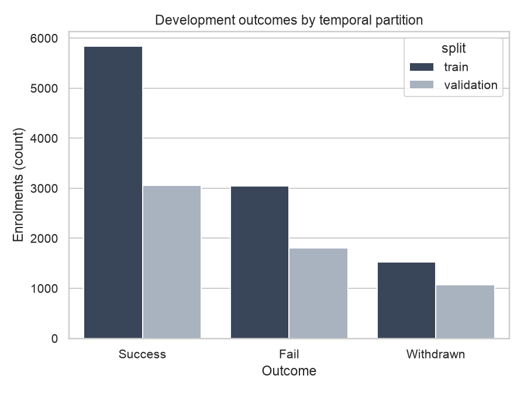
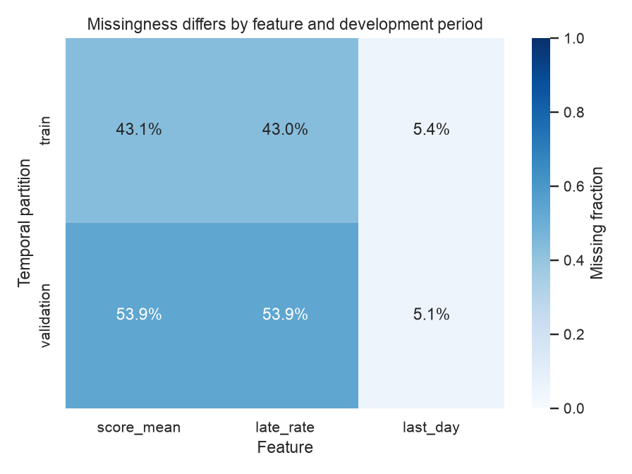
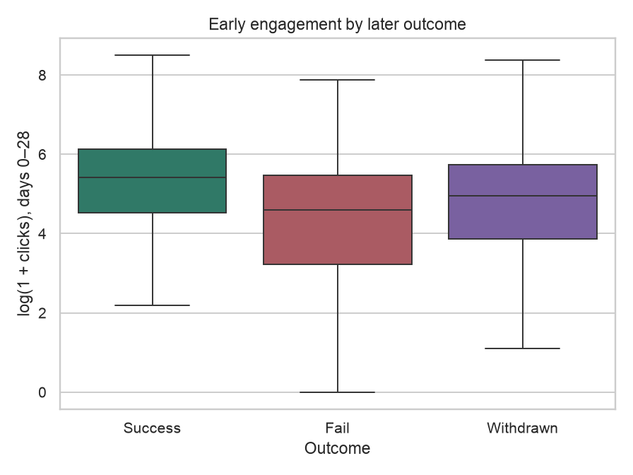
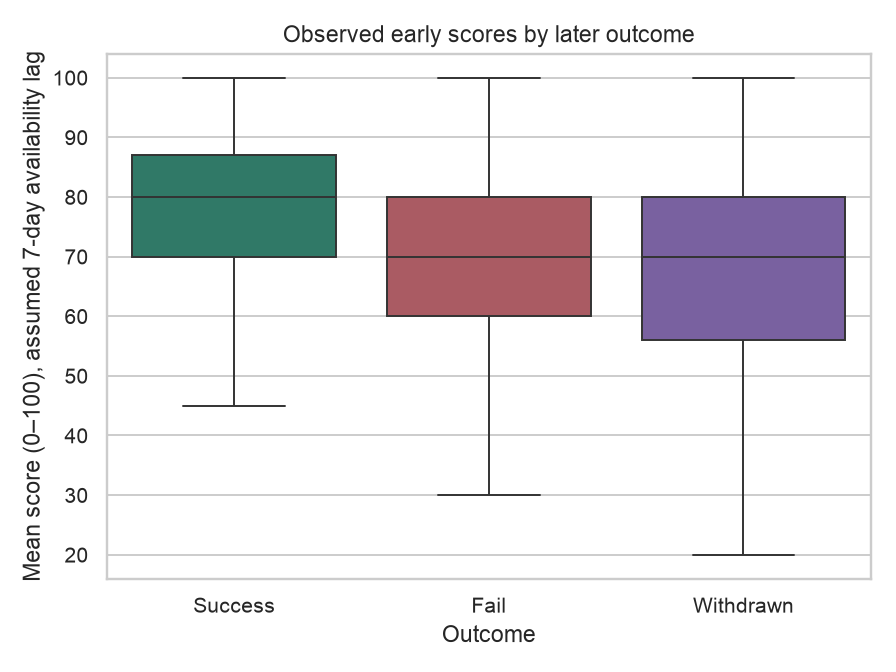
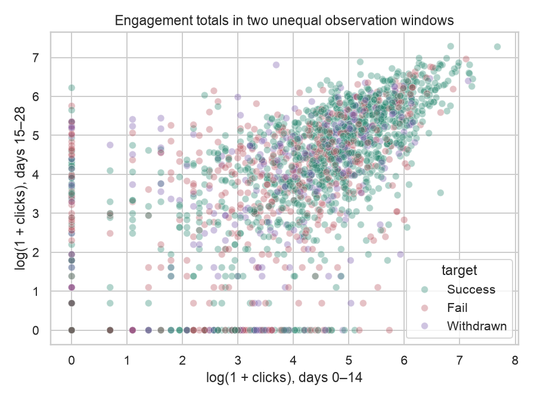
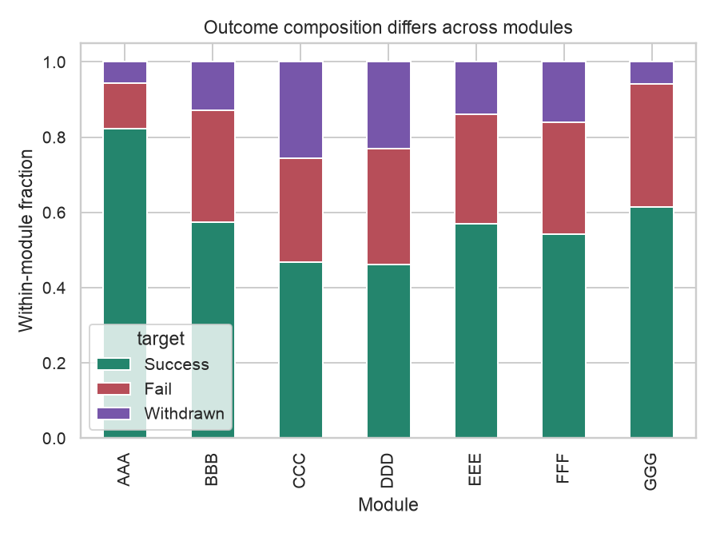
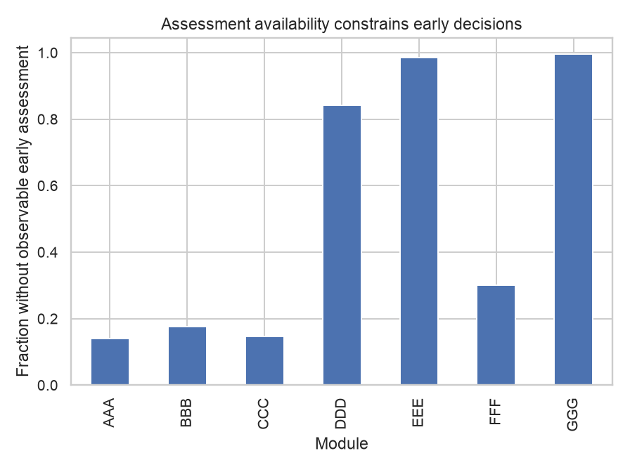
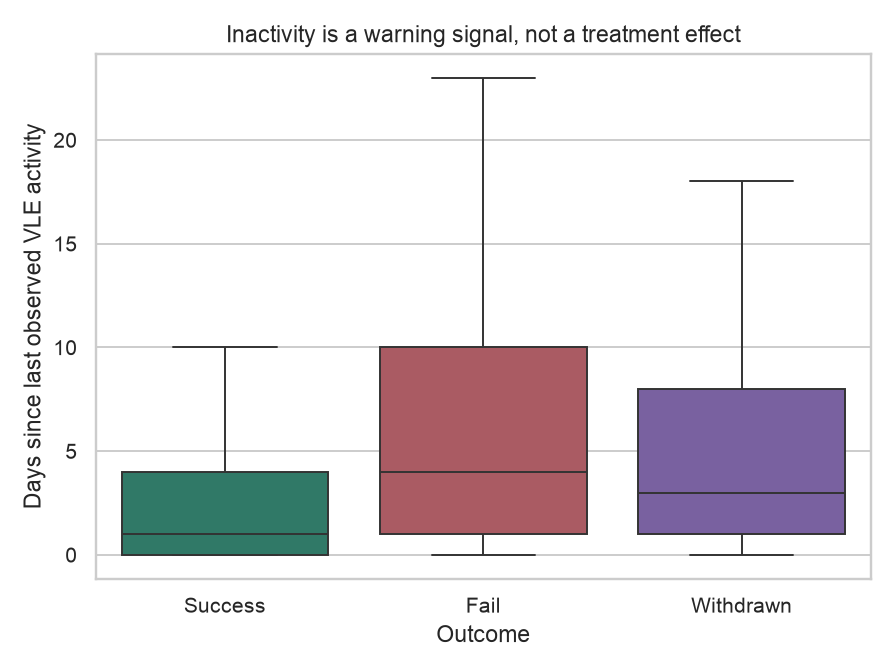
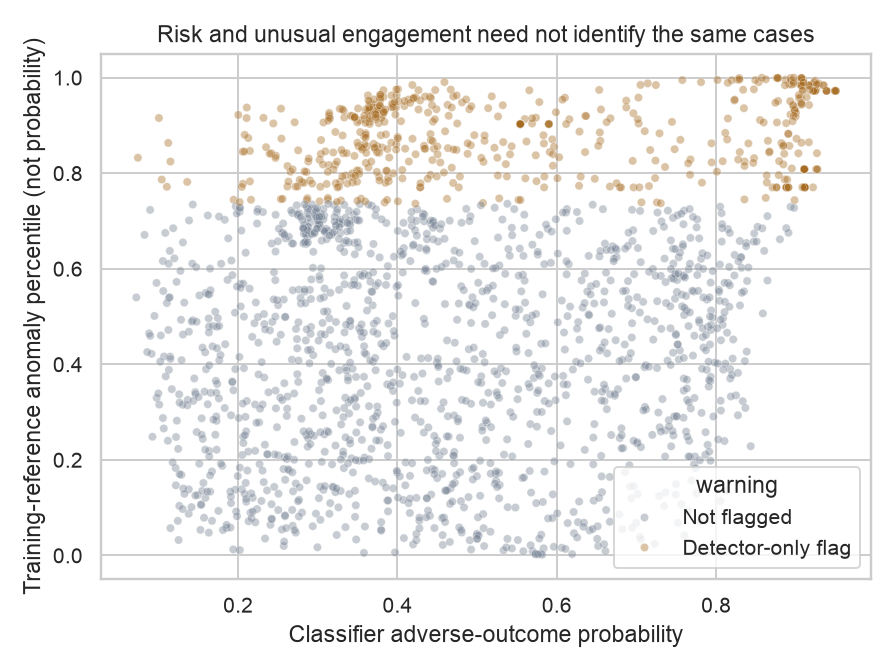
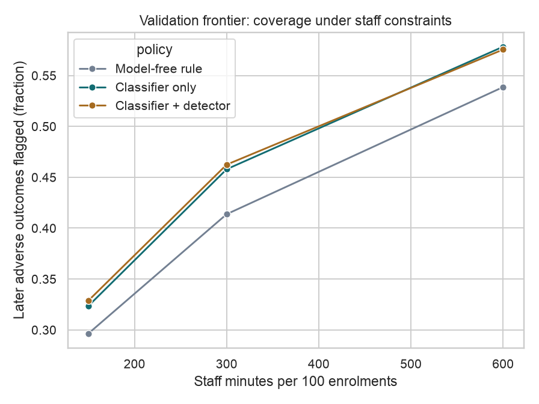

# TalentRoute — learner-support decision support

Mouza Al Darmaki · MAAI7101

## Interface preview


The offline dashboard introduces the decision, links to the evidence report, and opens the interactive decision room. The screenshot is from the reviewed Intermediate submission.

## Ten EDA, model and decision figures

Each chart answers a specific question. These are saved development figures from the reviewed Intermediate submission; the separate final cohort is not analysed in this gallery. See the [evidence report](intermediate/docs/baseline_report.md) for interpretation and limitations.

<details>
<summary>Open the ten figures and their explanations</summary>

### 1. How are outcomes distributed?

Success, Fail and Withdrawn counts in the training and validation partitions show the class balance.



### 2. Which inputs are missing?

Missing fractions for early scores, submission lateness and last activity differ by development period. Missing does not automatically mean disengaged.



### 3. How does engagement relate to later outcomes?

Day-0–28 click distributions are shown on a log1p scale. These are associations, not intervention effects.



### 4. What do observed early scores show?

Early-score distributions use qualifying submissions and an assumed seven-day availability lag; learners without observed scores are not represented by these box plots.



### 5. Do early and later engagement totals agree?

The scatter compares days 0–14 with days 15–28. These windows contain 15 and 14 days respectively, so totals are not equal-duration trends.



### 6. Do courses have similar outcomes?

Within-module outcome fractions reveal course differences that pooled performance can hide.



### 7. Is early assessment information equally available?

The fraction without a qualifying submission varies by course and period; assessment schedules can affect apparent warning signals.



### 8. Is inactivity a useful simple warning?

Days since last observed platform activity are compared across later outcomes, motivating the inactivity baseline.



### 9. Do risk and unusual engagement flag the same learners?

Classifier adverse-risk probability is compared with the detector's training-reference rarity percentile. Rarity is not a probability of failure or a verified anomaly label.



### 10. What does more staff time buy?

Validation coverage is compared at different staff-minute budgets for the rule, classifier and blend. Coverage measures targeting of later Fail/Withdrawn outcomes, not prevented failures.



</details>

## Current Intermediate submission

The current deliverable is in [`intermediate/`](intermediate/README.md). It combines learner-outcome classification and engagement outlier detection in a staff-time-constrained support queue, evaluated on real OULAD outcomes.

- [Intermediate report](intermediate/docs/baseline_report.md)
- [Project definition and final commitments](intermediate/docs/project_definition.md)
- [Data dictionary](intermediate/docs/data_dictionary.md)
- [Submission packages and verification](submission/README.md)

Use the packages named **Intermediate_2026-11-03_Reviewed** for this submission. The Full ZIP includes public data, aggregate results, the report and offline interactive pages. The Main_Code ZIP supplies source/configuration/documentation for audit; download data and regenerate outputs before viewing the artifact.

```sh
cd intermediate
just install
just pipeline
just app 300
```

Open `review/decision_room.html` for the guided prediction/evidence/recommendation experience, `review/index.html` for the project dashboard, and `review/report.html` for the readable report. All run offline after dependencies and data are available. The decision room uses saved development evidence; illustrative questions are labelled.

Python 3.14, `uv`, `just`, CPU only. Data: OULAD, Kuzilek, Hlosta & Zdrahal (2015), https://doi.org/10.24432/C5KK69, CC BY 4.0. A slower upstream download is avoided by the public CSVs bundled in the Full ZIP.

## Separate Final milestone

The repository root code and `docs/final_report.md` preserve a separately implemented, frozen Final milestone. Its held-out evaluation has already been observed. New investigations use development data only; they do not reopen that test or select a replacement candidate. The updated Intermediate report discloses this chronology.

Final packages and historical snapshots are separately named in `submission/`. Final scientific acceptance remains unmet because the detector's incremental value is uncertain. No intervention-effect or production-approval claim is made. The presentation and viva are separate deliverables.
