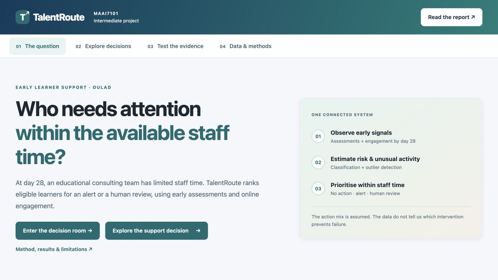

# TalentRoute — learner-support decision support

Mouza Al Darmaki · MAAI7101

## Interface preview



The offline dashboard introduces the decision, links to the evidence report, and opens the interactive decision room. The screenshot is from the reviewed Intermediate submission.

## Current Intermediate submission

The current deliverable is in [`intermediate/`](intermediate/README.md). It combines learner-outcome classification and engagement outlier detection in a staff-time-constrained support queue, evaluated on real OULAD outcomes.

- [Intermediate report](intermediate/docs/baseline_report.md)
- [Project definition and final commitments](intermediate/docs/project_definition.md)
- [Data dictionary](intermediate/docs/data_dictionary.md)
- [Submission packages and verification](submission/README.md)

Use the packages named **Intermediate_2026-11-03_Reviewed** for this submission. The Full ZIP includes public data, aggregate results, the report and offline interactive pages. The Main_Code ZIP supplies source/configuration/documentation for audit; download data and regenerate outputs before viewing the artifact.

```sh
cd intermediate
just install
just pipeline
just app 300
```

Open `review/decision_room.html` for the guided prediction/evidence/recommendation experience, `review/index.html` for the project dashboard, and `review/report.html` for the readable report. All run offline after dependencies and data are available. The decision room uses saved development evidence; illustrative questions are labelled.

Python 3.14, `uv`, `just`, CPU only. Data: OULAD, Kuzilek, Hlosta & Zdrahal (2015), https://doi.org/10.24432/C5KK69, CC BY 4.0. A slower upstream download is avoided by the public CSVs bundled in the Full ZIP.

## Separate Final milestone

The repository root code and `docs/final_report.md` preserve a separately implemented, frozen Final milestone. Its held-out evaluation has already been observed. New investigations use development data only; they do not reopen that test or select a replacement candidate. The updated Intermediate report discloses this chronology.

Final packages and historical snapshots are separately named in `submission/`. Final scientific acceptance remains unmet because the detector's incremental value is uncertain. No intervention-effect or production-approval claim is made. The presentation and viva are separate deliverables.
