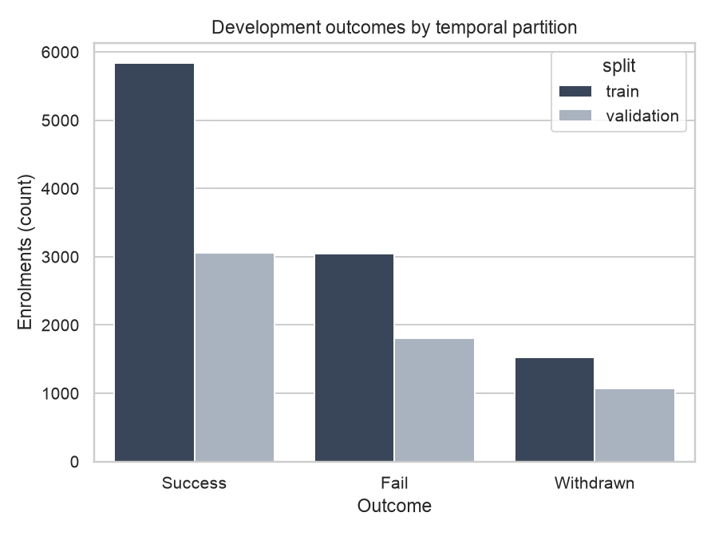
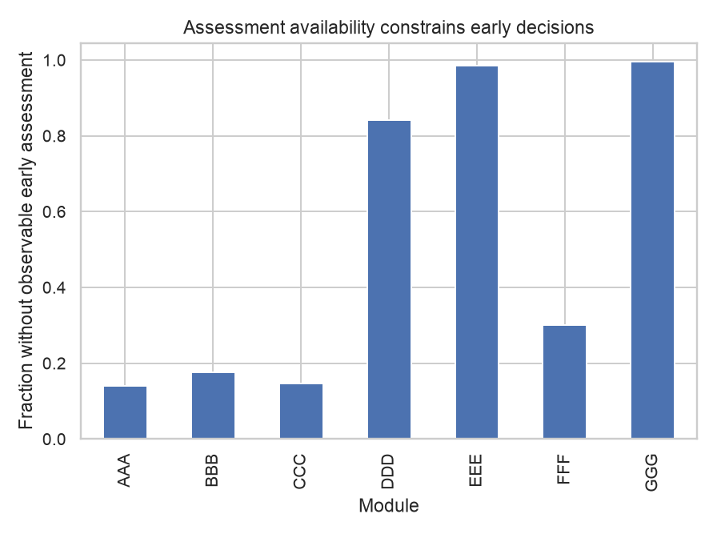
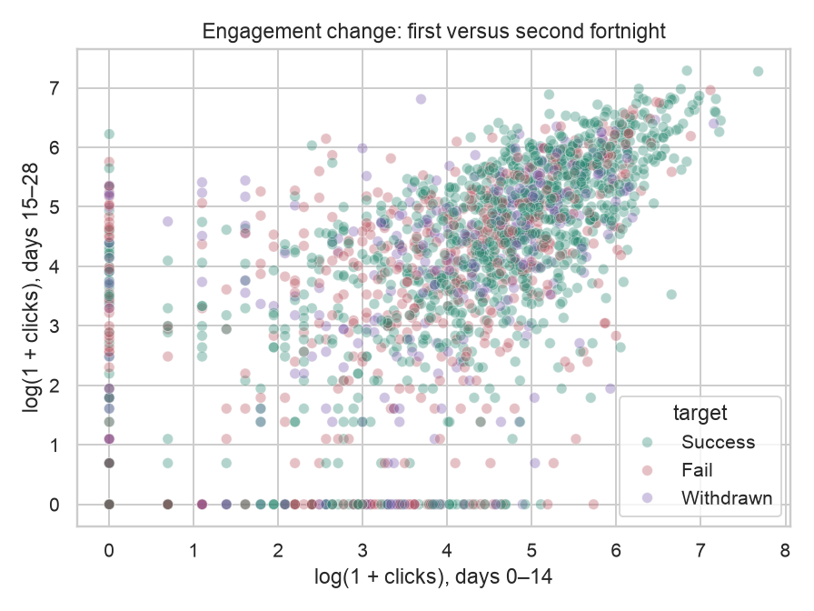

# Intermediate baseline and first-pass report

## Decision and changed framing
TalentRoute supports early learner-support triage under a finite staff-time budget. The observed population is distance-learning students. Corporate employee claims and score-derived causal uplift have been removed. Classification and outlier detection feed the same action policy. See project_definition.md for the current scope; later revisions are explicitly labeled.

## Data and partitions
Source: OULAD, Kuzilek, Hlosta & Zdrahal (2015), UCI doi:10.24432/C5KK69, CC BY 4.0. Download URL/checksum is recorded in data/raw/manifest.json. Decision time is day 28. Seven-day score availability is an assumption requiring sensitivity analysis, not observed marking time. No protected demographics are model inputs.

Data audit (outputs/data_audit.json): 32593 raw enrolments, 27515 eligible before group purging, 1959 earlier repeated-student enrolments removed. Retained partitions: training 10412, validation 5934, reserved test 9210. Training uses 2013, validation 2014B and reserved final test 2014J. No final test performance was computed. Outcome counts and assessment availability are in development_target_counts.csv and development_coverage.csv.

## Models and tuning
Logistic regression is the supervised baseline. Histogram boosting candidates use a small search specified in the original development code. Model selection maximizes validation adverse-outcome PR-AUC. Selected model: hgb_15_10. Isolation Forest uses engagement features plus module context, fitted on training data; its score is mapped through the training score distribution. The rule baseline combines poor early scores and inactivity.

Settings: logistic C=1, max_iter=1500; boosting max_iter=140, learning_rate=0.07, leaf/L2 candidates (7,2), (15,2), (15,10); Isolation Forest 150 trees, max_samples=512. Seed: 7101. Numeric preprocessing uses training medians with missing indicators and scaling; module uses one-hot encoding. Revision tree/forest/hybrid settings are recorded in src/talentroute/revision.py.

Validation model metrics (outputs/validation_model_search.csv):
```csv
model,adverse_pr_auc,fail_pr_auc,withdrawn_pr_auc,macro_f1,adverse_brier
logistic,0.7280,0.4870,0.2829,0.4001,0.2076
hgb_7_2,0.7442,0.4997,0.3034,0.4450,0.2025
hgb_15_2,0.7456,0.4887,0.3015,0.4515,0.2028
hgb_15_10,0.7472,0.4891,0.3072,0.4552,0.2023
```

## Decision results and ablation
All policies use the same eligible validation cohort, actions, effort budget and alert cap. Coverage measures later adverse outcomes flagged, not intervention effectiveness. Human and alert effort are explicit scenario assumptions in configs/policy.json. The validation-search candidate has anomaly weight 0.2; it remains an experimental comparison, not the recommended operating policy. The provisional operating reference uses weight zero (classifier-only) pending final specification; candidate evidence and uncertainty are reported below. The action mix is a declared workload rule: reviews go to the highest-ranked cases and alerts to the next cases. It does not learn treatment choice; either action counts equally toward coverage.

Validation decisions (outputs/validation_decision_metrics.csv):
```csv
policy,adverse_coverage,fail_coverage,withdrawn_coverage,flag_precision,human_n,alert_n,staff_minutes
business_rule,0.4137,0.4336,0.3801,0.6994,514,1186,17792.0000
logistic,0.4283,0.4269,0.4307,0.7241,514,1186,17792.0000
classifier_only,0.4579,0.4491,0.4728,0.7741,514,1186,17792.0000
anomaly_rule,0.3876,0.4241,0.3258,0.6553,514,1186,17792.0000
anomaly_only,0.3553,0.4042,0.2725,0.6006,514,1186,17792.0000
coupled_selected,0.4624,0.4679,0.4532,0.7818,514,1186,17792.0000
coupled_fixed_020,0.4624,0.4679,0.4532,0.7818,514,1186,17792.0000
```

Paired fixed-action student-cluster bootstrap 95% interval for selected coupled minus classifier-only coverage: [-0.0055, 0.0160] (outputs/validation_paired_interval.json). These validation-selected intervals are exploratory and not independent confirmation. The final added-component gate has not been evaluated on the reserved test.

## Does the second component earn its complexity?
```csv
detector,proxy_adverse_pr_auc,adverse_coverage,flag_precision
isolation_forest,0.5899,0.3553,0.6006
inactivity_rule,0.6300,0.3876,0.6553
```
These are outcome-relevance proxies, not verified anomaly labels. Proxy adverse PR-AUC: inactivity 0.6300, Isolation Forest 0.5899. The interval includes zero: improvement is inconclusive. Separate Fail/Withdrawn changes are reported in development_findings.md. Keep the simpler classifier as provisional operational reference; report the second component and negative evidence rather than forcing deployment.

## EDA and interpretation
Nine development EDA/model figures cover outcomes, missingness, engagement, scores, modules and detector disagreement; one frontier covers the decision. eda_feature_types.csv, eda_numeric_summary.csv, eda_missing_counts.csv and eda_sample_records.csv supply overview tables and five illustrative records without IDs. Missing scores are not zero; module differences are not individual ability.





## Sensitivity and deeper analyses
Executed development analyses write validation_sensitivity.csv, validation_uncertainty_analysis.csv, validation_challenge_segments.csv and validation_seed_stability.csv. The frontier plot shows coverage under changing staff budgets. These support sensitivity/ablation; the three committed deeper analyses are layer escape, warning-positive outcome profiles and general-versus-specialist models, as defined in project_definition.md. Numerical findings and operational recommendations are recorded in development_findings.md. Their hypotheses need independent final-test confirmation.

## Portability and limitations
Tables and figures in this generated report come from Darwin / Python 3.14.7. Historical platform comparisons are retained in evidence/platform-validation-2026-10-31/platform_comparison.csv; they concern an earlier code snapshot, not the current regeneration. Neither platform is claimed bit-identical to the other. Comparisons within this report use one platform consistently.

OULAD contains no randomized interventions or measured staff effort. We cannot claim prevented failures, retained students, ROI or transfer to employees. Anomaly relevance uses outcome proxies, not verified anomaly labels. Seven-day marking availability, day-28 cutoff, module shift and missing early assessment coverage require scrutiny. Bootstrap intervals do not capture all temporal drift. Seed stability covers the outlier layer only. Mac execution is tested separately. A historical Ubuntu VM run is saved under evidence/platform-validation-2026-10-31; it does not verify later code changes or container execution.

Final plan: freeze candidate/settings, execute reserved test once, retain negative evidence and verify clean Mac/Linux operation. Three analytical commitments and sensitivity designs are in project_definition.md. This Intermediate is not the final report.

## Exploratory revision after instructor feedback
These candidates and checks were added after viewing original validation results; they are exploratory, not confirmatory. Original model/policy files remain the historical reference. Final-test metrics remain unused.

```csv
model,adverse_pr_auc,fail_pr_auc,withdrawn_pr_auc,adverse_coverage
logistic,0.7280,0.4870,0.2829,0.4283
tree,0.7099,0.4650,0.2560,0.4489
forest,0.7478,0.5022,0.2861,0.4555
hgb_15_10,0.7472,0.4891,0.3072,0.4579
module_logistic_hybrid,0.7369,0.4871,0.2807,0.4475
```
Paired student-cluster bootstrap, forest minus historical hgb, conditional on the fitted models and validation selection:
```csv
metric,ci95_lower,ci95_upper,valid_repeats
adverse_pr_auc,-0.0032,0.0041,2000
fail_pr_auc,0.0025,0.0231,2000
withdrawn_pr_auc,-0.0372,-0.0070,2000
```
Three unadjusted exploratory intervals do not establish confirmatory superiority or equivalence. PR-AUC remains the selection metric; historical hgb is retained pending final specification. Specialists are also compared with flexible global models.

Same-total-quota layer diagnostics across all 24 orders and three tie seeds:
```csv
classifier_first_share,min,max
0.0000,0.4151,0.4179
0.5000,0.4388,0.4405
0.7500,0.4478,0.4499
0.9000,0.4530,0.4541
1.0000,0.4579,0.4579
```
Quota conclusions apply only to tested designs. outputs/revision/ contains ties, overlap, outcome-specific escape and historical profiles; selection-related profiles do not identify resilience mechanisms.

Action allocation remains a scenario, not measured benefit: action_break_even.csv uses observed adverse cases for evaluation after ranking without labels, varying alert caps with near-full budget expenditure and a reference operating mix. Comparing caps changes an operational constraint. Hypothetical effectiveness multipliers do not establish causal intervention effects or optimal allocation.

Uncertainty/frontier are sensitivity analyses; project_definition.md contains the single current list of three deeper analyses. Current-run verification is reported in outputs/current_pipeline_verification.json; historical VM evidence is separate under evidence/; the reserved final test is unused.

## Three analytical findings and limits
Layer quotas: tested mixed-design pooled coverage ranged 0.4151–0.4541, versus classifier-only 0.4579. These are exploratory quota-specific results, not a conclusion about layered detection generally.
Within the historical four-signal flagged set: Success: median inactivity 12 days, median score 62 from 277 observed scores; Fail: median inactivity 16 days, median score 48 from 262 observed scores; Withdrawn: median inactivity 9.5 days, median score 40 from 208 observed scores. Selection uses these features; these are descriptive profiles, not resilience causes or treatment effects.
Pooled PR-AUC: global logistic 0.7280, specialist hybrid 0.7369, forest 0.7478, historical boosting 0.7472. Training eligibility and pooled probability comparability constrain interpretation.

## Model diagnostics
Classifier-only reaches 127 additional adverse cases of 2874 versus the rule at the same workload; coverage difference 0.0442, exploratory paired interval [0.0257, 0.0633]. Historical rule ties remain unchanged; seeded tie checks gave 0.4116–0.4130 coverage versus historical 0.4137.
```csv
model,split,adverse_pr_auc,log_loss
logistic,train_resubstitution,0.7208,0.8474
logistic,validation_selection,0.7280,0.9145
hgb_15_10,train_resubstitution,0.7636,0.7946
hgb_15_10,validation_selection,0.7472,0.9021
```
Ten shuffled-training-label controls produced validation ROC-AUC 0.412–0.514 (random-ranking reference 0.5). Randomly fitted scores can rank validation cases inversely, so a value below 0.5 alone is not evidence of leakage. This limited negative control cannot certify absence of leakage. Grouped permutation diagnostics and a code/config/data fingerprint are in outputs/diagnostics/. Correlated feature groups move together; predictive reliance is not causality. No expert ceiling, production performance or manually verified label-error rate is available. Performance remains limited: many later adverse outcomes are missed and missing assessments restrict early information.

## What the observed errors imply
```csv
group,n,adverse_n,flagged_adverse_n,missed_adverse_n,coverage
0,2737,1099,380,719,0.3458
1,3197,1775,936,839,0.5273
```
Group 1 lacks an observable early assessment; group 0 has one. Compare counts and coverage together: differences are descriptive, not proof that missing scores cause an error. Missingness motivates checking the engagement-only pathway, not assigning a zero score. Module slices in missed_case_profile.csv locate uneven targeting; interpret only rows passing the minimum-n guard. These slices do not establish discrimination or a correct intervention.
The historical classifier improves targeting over the rule at identical effort, yet many adverse cases remain missed. Added detector complexity has no confirmed benefit in the paired interval. The detector/risk scatter illustrates disagreement; disagreement alone does not establish useful complementarity. Specialist comparisons test course heterogeneity without establishing specialist deployment superiority.

## Final execution plan (not completed test results)
1. Before opening 2014J, record a dated final specification: predictor availability, one candidate, action mix/costs, tie rule, primary metrics and acceptance criteria. Retain the current model-free and classifier-only references.
2. Complete the three commitments on the frozen design: layer escape at equal quota, warning-positive outcome profiles with observed-score denominators, and global-versus-specialist comparison with training-only eligibility. Retain budget/cost/cutoff sensitivities as separate scenario analyses. Report negative findings and outcome tradeoffs.
3. Only after freezing, evaluate reserved 2014J once using the same metrics and student-cluster intervals. Do not tune or repair the acceptance rule using that test. Report cohort shift and errors, verify an extracted release in the grading environment, and explain each conclusion using saved evidence.
