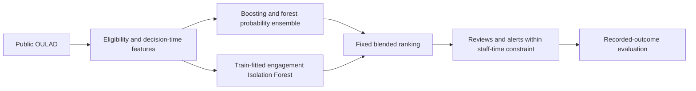
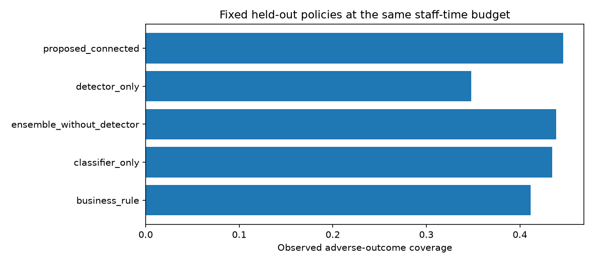
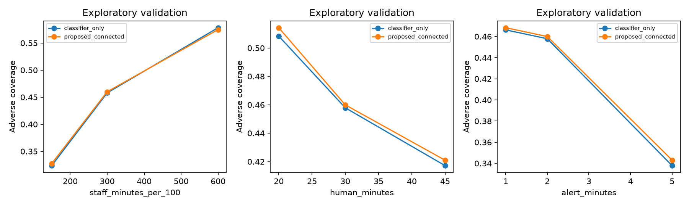

# TalentRoute final evaluation

## 1. Executive summary
An educational consulting team serving universities or learning providers needs an auditable support-review and alert queue within limited staff time. We built a classification-plus-engagement-detector candidate and evaluated recorded outcomes, not the effect of contacting learners. The final candidate combines forest and boosting probabilities before adding the detector score to the budgeted ranking. Under the same staff-time budget, the connected candidate identifies 130 more recorded adverse cases than the simple rule. Its result is below.

| policy | adverse_coverage | flag_precision | human_precision | missed_adverse_n | staff_minutes |
| --- | --- | --- | --- | --- | --- |
| business_rule | 0.4117 | 0.5856 | 0.6617 | 2209 | 27624.0000 |
| classifier_only | 0.4346 | 0.6182 | 0.8459 | 2123 | 27624.0000 |
| ensemble_without_detector | 0.4386 | 0.6239 | 0.8434 | 2108 | 27624.0000 |
| detector_only | 0.3481 | 0.4951 | 0.6291 | 2448 | 27624.0000 |
| proposed_connected | 0.4463 | 0.6348 | 0.8383 | 2079 | 27624.0000 |

**Acceptance decision:** Do not endorse the added complexity. Retain the simpler reference pending new independent evidence. This recommendation follows the recorded acceptance checks, not visual appeal or technique count. No prevention, ROI or employee-performance benefit is inferred.

## 2. Problem recap and changes since Intermediate
The original employee-training recommendation framing was refined to educational-consultancy learner-support targeting because OULAD contains student outcomes, not employee or intervention-effect labels. The intended client-facing consulting team designs learning plans, assessments and support processes; the evaluated software addresses only support prioritisation. The consulting use case serves university and other learners directly, without equating students with employees. This prototype has not been validated in a client deployment. This change was documented in the Intermediate. Pass and Distinction map to Success; Fail and Withdrawn remain separate. No outcome labels were fabricated.

Relative to the Intermediate, this release adds a fixed forest/boosting probability ensemble, a hashed pre-test freeze, separate held-out evaluation, paired acceptance checks, complete component ablations, and a final report. The ensemble tests whether averaging two model families yields a more useful ranking; it is not asserted to improve performance in advance. Current detector evidence is weak, so the connected system is an experimental candidate, not a deployment promise. Contextual-detector experiments remain development-only negative checks and are not silently substituted after test results.

## 3. Proposed system

The classifier retains distinct outcome probabilities. The detector learns unusual engagement without outcome labels; its training-reference percentile is not a failure probability. Shared engagement inputs mean these components are not statistically independent. Both feed the experimental ranking. Reviews take priority positions; alerts use the subsequent positions in that same ranking. The artifact does not claim a separate anomaly-only intervention pathway.

| parameter | value |
| --- | --- |
| staff_minutes_per_100 | 300.0000 |
| human_minutes | 30.0000 |
| alert_minutes | 2.0000 |
| alert_budget_fraction | 0.2000 |
| max_alert_fraction | 0.2000 |
| score_delay_days | 7.0000 |
| forest_weight | 0.5000 |
| anomaly_weight | 0.2000 |
| max_flag_precision_loss | 0.0200 |

The frozen configuration, weights and acceptance thresholds are recorded in `outputs/final/freeze.json`. Effort costs, budget and alert limits are configurable planning assumptions. Coverage counts either contact equally; it is not treatment-effect optimisation. The grading-availability lag is assumed because actual grading timestamps are absent.

## 4. Evaluation setup, results and tuning
Training and validation precede the held-out presentation chronologically; student identities are disjoint. Feature imputation and encoders fit training only. Predictors exclude protected attributes, final outcomes and future withdrawal. Eligibility and feature-availability rules are detailed in the Intermediate data dictionary. Protected fields support aggregate audits only.

Intermediate boosting settings and blend candidates were compared on validation; these are exploratory selections. The final forest/boosting averaging weight was fixed by design before test evaluation rather than selected on test. The frozen model, data and implementation hashes prevent silent replacement. Primary ML metric is adverse PR-AUC: relevant to ranking eventual adverse cases. Separate outcome PR-AUC, macro-F1, log loss and Brier assess distinctions and probability quality. Primary decision metric is coverage within staff time; precision describes unnecessary contacts. Detector metrics use recorded outcomes as relevance proxies, never anomaly ground truth.

| model | adverse_pr_auc | macro_f1 | log_loss | fail_pr_auc | withdrawn_pr_auc | adverse_brier |
| --- | --- | --- | --- | --- | --- | --- |
| logistic | 0.5445 | 0.3631 | 1.0032 | 0.2988 | 0.3148 | 0.2402 |
| hgb_7_2 | 0.6456 | 0.3998 | 0.9112 | 0.3626 | 0.3095 | 0.2137 |
| hgb_15_2 | 0.6495 | 0.4051 | 0.9108 | 0.3555 | 0.3251 | 0.2129 |
| hgb_15_10 | 0.6534 | 0.4021 | 0.9071 | 0.3556 | 0.3282 | 0.2125 |
| proposed_ensemble | 0.6500 | 0.3822 | 0.9066 | 0.3635 | 0.3244 | 0.2119 |

| detector | proxy_adverse_pr_auc | adverse_coverage | flag_precision |
| --- | --- | --- | --- |
| isolation_forest | 0.5091 | 0.3481 | 0.4951 |
| inactivity | 0.5539 | 0.4019 | 0.5716 |

Primary-metric uncertainty and paired coverage differences use student-cluster resampling, preserving repeated enrolments. These intervals describe sampling uncertainty conditional on the fitted system and data; they do not establish population transportability.

| metric | low | high |
| --- | --- | --- |
| adverse_pr_auc | 0.6340 | 0.6660 |
| adverse_coverage | 0.4307 | 0.4626 |

| comparison | low | high |
| --- | --- | --- |
| proposed_connected minus business_rule | 0.0212 | 0.0475 |
| proposed_connected minus classifier_only | 0.0030 | 0.0208 |
| proposed_connected minus ensemble_without_detector | -0.0011 | 0.0160 |

The proposed ensemble has adverse PR-AUC 0.6500, compared with 0.6534 for the original boosting model. A better fixed-budget contact list does not imply universally better ranking or classification. The lower macro-F1 also limits claims about assigning the three outcome labels.

The acceptance JSON records whether the lower paired bounds beat the references and whether precision loss stays within the frozen tolerance. A zero-crossing interval is inconclusive. No post-test tuning or positive-result substitution is permitted.

## 5. Ablation
`outputs/final/ablation.csv` compares the business rule, original classifier, ensemble without detector, detector alone and connected proposal at the same capacity. Removing the detector isolates its incremental contribution; replacing the ensemble with the original classifier isolates the model-family change. Detector relevance is also compared with inactivity. Negative results favour simpler models rather than justify additional complexity.

## 6. Sensitivity and stability
Development sensitivity varies staff budget, human-review effort, alert effort and detector weight. These are scenario assumptions, not estimated real costs. Ranges bracket the configured scenario and represent lighter/heavier staff availability and contact effort; operational stakeholders must validate them before use. Additional data-availability and cutoff checks appear in `outputs/validation_data_assumptions.csv`. Detector-seed checks are in `outputs/final/development_seed_stability.csv`.

These curves evaluate the frozen ensemble/detector candidate on development validation, including alternative detector seeds. They show sensitivity to declared scenarios rather than transportability to a new institution. They do not permit redesign after final-test results.

## 7. Three deeper analyses
The Intermediate committed to layer escape, warning-positive outcome profiles and module-specialist versus global models. Implementations and aggregate results remain under `outputs/revision/`; all were development analyses, not independent confirmation.

| policy | adverse_coverage | flag_precision | staff_minutes |
| --- | --- | --- | --- |
| classifier_only | 0.4579 | 0.7741 | 17792.0000 |
| four_layer_round_robin | 0.4189 | 0.7082 | 17792.0000 |

**Complementarity / layer escape:** `same_quota_layers.csv`, `layer_quota_sensitivity.csv` and `tie_sensitivity.csv` test signal combinations within a shared total quota. The original pooled mixture did not generally beat classifier ranking. Recommendation: do not equate more warning layers with better targeting; retain capacity-matched comparisons.

**Challenge profiles:** `warning_outcome_profiles.csv` compares historical warning-positive Success, Fail and Withdrawn cases. Success despite warnings does not establish resilience mechanisms or intervention benefit. Recommendation: use profiles as prompts for human review, not causal prescriptions. These historical signals differ from the current policy flags.

| model | adverse_pr_auc | adverse_coverage | flag_precision |
| --- | --- | --- | --- |
| logistic | 0.7280 | 0.4283 | 0.7241 |
| tree | 0.7099 | 0.4489 | 0.7588 |
| forest | 0.7478 | 0.4555 | 0.7700 |
| hgb_15_10 | 0.7472 | 0.4579 | 0.7741 |
| module_logistic_hybrid | 0.7369 | 0.4475 | 0.7565 |

**Segment-specific models / reconciliation:** `model_comparison.csv`, `specialist_eligibility.csv` and `forest_minus_hgb_intervals.csv` compare global and specialist models. Specialist eligibility uses training counts; stronger global comparators prevent a weak baseline from overstating specialist value. Recommendation: do not deploy specialists solely because they beat global logistic. The paired development check below quantifies the specialist/global-logistic comparison; this is not confirmation against a stronger global ensemble.

| metric | difference_mean | ci95_lower | ci95_upper | valid_repeats | contains_zero | interpretation |
| --- | --- | --- | --- | --- | --- | --- |
| adverse_pr_auc | 0.0091 | 0.0019 | 0.0157 | 2000 | False | exploratory, conditional on fitted models and original validation selection |
| fail_pr_auc | 0.0000 | -0.0086 | 0.0086 | 2000 | True | exploratory, conditional on fitted models and original validation selection |
| withdrawn_pr_auc | -0.0020 | -0.0140 | 0.0102 | 2000 | True | exploratory, conditional on fitted models and original validation selection |

| outcome | feature | n | median |
| --- | --- | --- | --- |
| Fail | log_clicks | 786 | 3.0910 |
| Fail | inactive_days | 786 | 16.0000 |
| Success | log_clicks | 496 | 4.0859 |
| Success | inactive_days | 496 | 12.0000 |
| Withdrawn | log_clicks | 418 | 4.0859 |
| Withdrawn | inactive_days | 418 | 9.5000 |

These mappings make explicit how the committed analyses relate to the proposal's deeper-analysis categories. Each sharpens a recommendation; none establishes a causal support mechanism.

## 8. Insights and recommendations
Use the recorded acceptance outcome in the executive summary. If the connected candidate fails, retain the simpler reference pending new independent evidence rather than force the second technique into operations. The experimental second technique remains implemented and evaluated; the evaluated final candidate connects both techniques, while its operational fallback is explicitly simpler. This distinction is disclosed rather than presenting experimental inclusion as deployment approval.

Review Fail and Withdrawn separately because a pooled improvement may hide a loss for one outcome. See `test_metrics.csv`. Inspect course and missing-assessment segments before deployment; `test_segments.csv` marks when sample sizes permit interpretation. Budget changes alter contact volume and missed cases, not demonstrated prevented failures. A human reviewer should confirm context before contacting a learner.

## 9. Limitations and risks
The dataset is old and institution-specific. Course shift, repeat-student exclusions, unobserved grading availability and missing assessments limit generalisation. Activity anomalies lack verified labels. Neither assumed effort nor contact effectiveness is measured. Low-count segments are not evidence of fairness. Contact policies can create feedback loops; future monitoring should record workload, complaints, drift and subgroup errors. Public-data identifiers are excluded from released worklists; the demonstration uses synthetic case references, not synthetic research outcomes.

A current Mac run does not certify Linux-container compatibility. Runtime and operating-system verification must be supplied for this release before claiming portability. Any unmet criterion remains a limitation, not a passed checkbox.

## 10. Connection to the original problem and next steps
The project delivers an auditable learner-support targeting experiment that an educational consulting team could use when advising a university. It does not evaluate a complete learning-plan or assessment-management platform, nor establish validity for other providers or corporate L&D. It retains the original goal of supporting resource-constrained decisions while rejecting unsupported uplift. The next useful data are actual contact times, grading-availability timestamps, and ethically collected intervention outcomes. A prospective human-reviewed pilot would be needed to estimate whether acting improves outcomes. The viva and presentation are separate assessments; explanations here must remain defensible in both.

Data: Kuzilek, Hlosta and Zdrahal, OULAD, UCI DOI 10.24432/C5KK69, CC BY 4.0. Further schema and preparation details: `data_dictionary.md` and `project_definition.md`.
