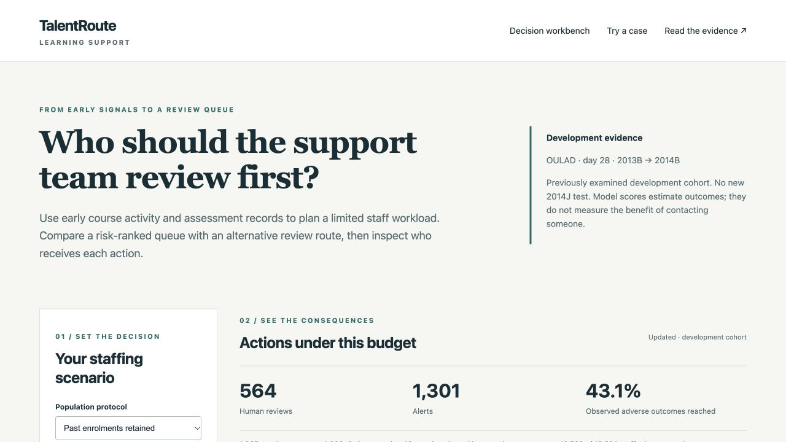

# TalentRoute — learner-support workbench

An educational support coordinator can change staffing time and eligibility, inspect a review/alert queue, and see which course cases receive attention. A second experiment changes early-course inputs and scores them using fitted models.



This is the **development revision after Intermediate feedback**, derived from the submitted project. It preserves classification plus outlier detection and the three promised analyses. It does not replace submitted archives or claim a new independent final test. The historical final cohort has already been examined and is not scored here. Final confirmation remains unresolved.

## Run

Python 3.14, `uv` and `just`; CPU only, no credentials or LLM calls.

```sh
just install
just pipeline
just app
```

Open http://127.0.0.1:8800. To change the port: `just app 8801`. The pipeline verifies or downloads the pinned public dataset, prepares features, fits the bounded development grid, evaluates routes, runs sensitivity and the three deeper analyses, writes the report/figures, and runs tests. Each stage executes once. Actual timings are in `outputs/runtime.csv`; download time depends on the connection. The app reads fitted artifacts and never trains.

For the original assessment-enabled experiment, the provisional choice was logistic regression with C=1 and the risk-ranked queue. The availability remediation below defines the assessment-free mode used when score-release timing is unverified. The bounded search, selection rule and limitations are documented in `docs/development_protocol.md`; selection evidence is in `outputs/development_selection.csv` and `outputs/proposed_system.csv`. This is post-feedback development selection, not independent final confirmation. Isolation Forest remains a connected, selectable review-reserve experiment; its additional targeting gain was not established.

- `docs/final_report.md`: concise results, reasoning and limitations.
- `docs/project_definition.md`: retained commitments and changes.
- `docs/data_dictionary.md`: why each feature is appropriate and its limits.
- `outputs/`: generated numerical evidence and figures.
- `src/talentroute/`: data, models, policy, evaluation, analyses, report and one app.

The app defaults to the operational companion and reads the selected model from the generated selection file. The operational training companion retains mature past enrolments; the identity-disjoint companion is a separate evaluation design. Both use the same evaluation cases. A review is a course-enrolment case; people with multiple enrolments require coordination before outreach. Queue export omits student identifiers, demographics and outcomes.

Costs and action values are assumptions. Predicted risk is not a measure of intervention benefit; an anomaly percentile is not an outcome probability. The single-case experiment is not a causal simulation. No clustering is used.

The workload panel freezes the current case plan, increases assumed effort, and compares explicit deferral with replanning within the same staffing budget. It exposes infeasibility; it does not claim optimal intervention value. A separate grouped half-split diagnostic examines selection stability within already-examined development data. Neither extension creates an independent final test. Tests also check that future records cannot change day-28 features and that unknown assessment deadlines remain unknown.

`just run-model` fits the components and evaluates their decision queues. `just evaluate` recomputes evaluations; `just ablation` also draws the paired route-comparison plot. They are separate entry points, not duplicate pipeline stages. Other recipes remain independently runnable after their inputs exist. `just clean` removes generated outputs and processed data, keeping raw downloads and authored documents. It also removes the generated final report, which `just report` rebuilds after its input stages.

Data: [UCI Open University Learning Analytics Dataset](https://archive.ics.uci.edu/dataset/349/open+university+learning+analytics+dataset), Kuzilek, Hlosta and Zdrahal, CC BY 4.0. Raw CSV checksums are pinned in the configuration. Do not distribute `.venv`, caches or raw/processed student-level files in a public code package; the download recipe provides reproducible access. Preserve the license notice and cite the source.

## Explain, check, compare

The existing workbench includes three decision tools, inspired by the Beyond Predictions lab:

- **Why does this plan fit?** Read the time, whole-action, place and risk rules with their actual usage. The initial alert budget share is a reservation, not a final spending ceiling.
- **Try your own plan.** Change up to nine anonymous example cases; all other actions remain fixed. The separate policy checker accepts or rejects the full plan without reading outcomes. Manual edits are a sandbox and do not change the queue or its CSV export.
- **What changed from my saved settings?** Save a Before, adjust settings, and compare actions, workload and selected cases by course. Changing population protocol clears the saved point.

See [the short demo walkthrough](docs/decision_demo.md). These tools clarify a constructed policy, not measured institutional rules or causal benefits. No new model training or 2014J evaluation is introduced.


[Independent confirmation status and future protocol](docs/final_confirmation_plan.md) explains the remaining evaluation gap. No fresh cohort is currently available.

## Stage inputs

After `prepare-data`, `eda` writes descriptive CSVs and plots. `run-model` fits and evaluates. `run-baseline`, `sensitivity`, `calibration` and `deep-dives` require fitted predictions; sensitivity and deeper comparisons also require the selection file from `evaluate`. `evaluate` produces warning profiles. `deep-dives` produces reconciliation, specialists, action-value and workload stress analyses. `report` requires these outputs, the selection-stability results and `availability-audit`. Use `just pipeline` to execute the complete dependency order once.

## Availability remediation

`just availability-audit` uses three learner-grouped folds within 2013B to select each of two feature variants, refitting preprocessing within every fold. It then evaluates 2014B, which has previously been examined: this is retrospective evaluation, not a new independent test. The assessment-free variant excludes all five assessment-derived fields regardless of its measured performance. The app exposes it as a separate model; assessment edits do not change its predictions. Use this mode when score-release timing cannot be verified. The original model outputs remain visible for the historical comparison.

The full local pipeline after this addition completed in 18.3 seconds with cached raw data; 48 tests passed, including assessment/outcome mutation invariance and rejection of evaluation-period rows in selection. The updated full Linux pipeline also passed 48 tests in 35.2 seconds, reusing the installed environment and cached verified raw data while regenerating models and outputs. See `outputs/availability_audit.csv` for the performance cost and uncertainty; no independent-validation or intervention-effect claim is made.
