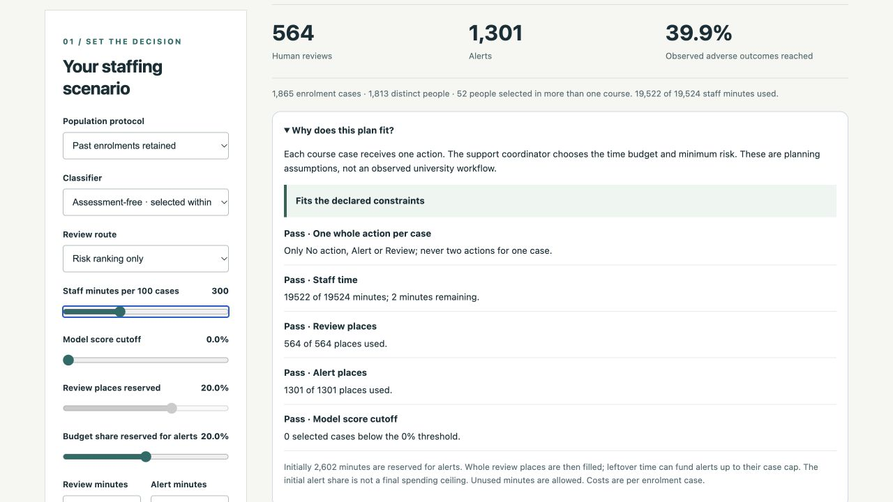
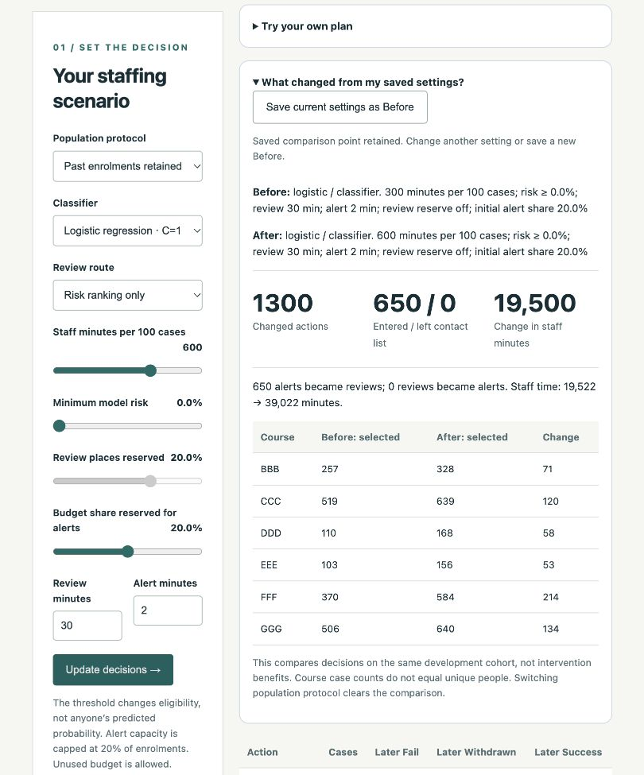

# TalentRoute — learner-support workbench

An educational support coordinator can change staffing time and eligibility, inspect a review/alert queue, and see which course cases receive attention. A second experiment changes early-course inputs and scores them using fitted models.



This is the **development revision after Intermediate feedback**, derived from the submitted project. It preserves classification plus outlier detection and the three promised analyses. It does not replace submitted archives or claim a new independent final test. The historical final cohort has already been examined and is not scored here. Final confirmation remains unresolved.

## Run

Python 3.14, `uv` and `just`; CPU only, no credentials or LLM calls.

```sh
just install
just pipeline
just app
```

Open http://127.0.0.1:8800. To change the port: `just app 8801`. The pipeline verifies or downloads the pinned public dataset, prepares features, fits the bounded development grid, evaluates routes, runs sensitivity and the three deeper analyses, writes the report/figures, and runs tests. Each stage executes once. Actual timings are in `outputs/runtime.csv`; download time depends on the connection. The app reads fitted artifacts and never trains.

The final demonstration defaults to **assessment-free logistic regression**, selected by learner-grouped cross-validation within 2013B, with risk-only routing. Every current comparison, segment audit, sensitivity sweep and deeper analysis is in `outputs/final_*.csv`. Unprefixed assessment-enabled outputs record earlier experiments and are not the final recommendation. `availability_selection.csv` records the six-candidate training-only search. Isolation Forest remains a connected, selectable review-reserve experiment; incremental targeting gain is not established.

- `docs/final_report.md`: concise results, reasoning and limitations.
- `docs/project_definition.md`: retained commitments and changes.
- `docs/data_dictionary.md`: why each feature is appropriate and its limits.
- `outputs/`: generated numerical evidence and figures.
- `src/talentroute/`: data, models, policy, evaluation, analyses, report and one app.

The app defaults to the operational companion and uses the assessment-free model selected within the training cohort. The operational training companion retains mature past enrolments; the identity-disjoint companion is a separate evaluation design. Both use the same evaluation cases. A review is a course-enrolment case; people with multiple enrolments require coordination before outreach. Queue export omits student identifiers, demographics and outcomes.

Costs and action values are assumptions. Predicted risk is not a measure of intervention benefit; an anomaly percentile is not an outcome probability. The single-case experiment is not a causal simulation. No clustering is used.

The workload panel freezes the current case plan, increases assumed effort, and compares explicit deferral with replanning within the same staffing budget. It exposes infeasibility; it does not claim optimal intervention value. A separate grouped half-split diagnostic examines selection stability within already-examined development data. Neither extension creates an independent final test. Tests also check that future records cannot change day-28 features and that unknown assessment deadlines remain unknown.

`just run-model` fits the components and evaluates their decision queues. `just evaluate` recomputes evaluations; `just ablation` also draws the paired route-comparison plot. They are separate entry points, not duplicate pipeline stages. Other recipes remain independently runnable after their inputs exist. `just clean` removes generated outputs and processed data, keeping raw downloads and authored documents. It also removes the generated final report, which `just report` rebuilds after its input stages.

Data: [UCI Open University Learning Analytics Dataset](https://archive.ics.uci.edu/dataset/349/open+university+learning+analytics+dataset), Kuzilek, Hlosta and Zdrahal, CC BY 4.0. Raw CSV checksums are pinned in the configuration. Do not distribute `.venv`, caches or raw/processed student-level files in a public code package; the download recipe provides reproducible access. Preserve the license notice and cite the source.

## Explain, check, compare

The existing workbench includes three decision tools, inspired by the Beyond Predictions lab:

- **Why does this plan fit?** Read the time, whole-action, place and risk rules with their actual usage. The initial alert budget share is a reservation, not a final spending ceiling.
- **Try your own plan.** Change up to nine anonymous example cases; all other actions remain fixed. The separate policy checker accepts or rejects the full plan without reading outcomes. Manual edits are a sandbox and do not change the queue or its CSV export.
- **What changed from my saved settings?** Save a Before, adjust settings, and compare actions, workload and selected cases by course. Changing population protocol clears the saved point.

See [the short demo walkthrough](docs/decision_demo.md). These tools clarify a constructed policy, not measured institutional rules or causal benefits. No new model training or 2014J evaluation is introduced.



[Independent confirmation status and future protocol](docs/final_confirmation_plan.md) explains the remaining evaluation gap. No fresh cohort is currently available.

## Stage inputs and evidence

After data preparation, `run-model` fits the historical comparators, the training-selected assessment-free model and both connected components, then evaluates the final decision queues. `evaluate`, `ablation`, `sensitivity` and `deep-dives` regenerate the final-system analysis suite from fitted artifacts; ablation and sensitivity also regenerate final figures. These individual recipes share one implementation. The full pipeline runs each historical stage once, then the availability audit, final analyses, report and tests once. Use `just pipeline` for a clean dependency order.

The assessment-free variant removes scores because release timing is unverified. Removing submission-derived fields too is conservative; a submission-only variant was not tested. Assessment edits cannot change its predictions. Matched feature-removal results are in `outputs/availability_audit.csv`. The same final model drives the report and default app; the original models remain explicitly labeled historical choices.

Current runtime and verification results are recorded after a complete pipeline run. Independent final confirmation remains unavailable: both evaluation cohorts were previously examined. No current recipe scores 2014J. Do not interpret retrospective improvements, bootstrap intervals or seed checks as an independent test.

## Verified reproduction

On 22 November 2026, the complete updated pipeline passed 50 tests on macOS (Python 3.14.7; 21.8 seconds) and Linux amd64 (Python 3.14.2; 43.7 seconds). Both used cached, checksum-verified raw data and an installed environment; first download and installation add time. These are execution checks, not independent model validation.

Cross-platform comparison reproduced the final decision counts, sensitivity and subgroup outputs. One operational Withdrawn AP differed by less than 0.000007; primary adverse AP and coverage were unchanged.

## Reading the code and interpreting decisions

Start with `decision.py` for capacity and allocation, `plan.py` for the outcome-free checker, and `app.py` for explain/check/compare. `default_model()` is the final app choice; `historical_selected_model()` is used only by the labeled earlier analysis. `final_analysis.py` generates current evidence and `final_report.py` renders it. `report.py` now contains EDA, the historical budget plot, table formatting and the report entry point; unused historical plot functions were removed.

The app caches fitted artifacts until their file versions change and returns a separate data frame to each request. It never fits models. Both historical and final numerical stages remain in the full pipeline to reproduce the experiment history, each once; they are not two competing final reports.

No action can mean capacity ran out, not that a learner is safe. A higher budget changes assignments, not fitted predictions. Replanning can restore feasibility after effort changes, but is not proven optimal without actual intervention values. The report's decision table states when to reconsider each recommendation.

After code simplification, the full macOS pipeline completed in 20.5 seconds with 52 tests passing. All 16 final aggregate CSVs were byte-identical to the preceding version. The extra tests check cached-data isolation and refresh after artifact changes.
