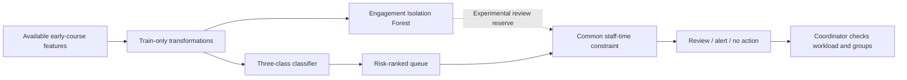
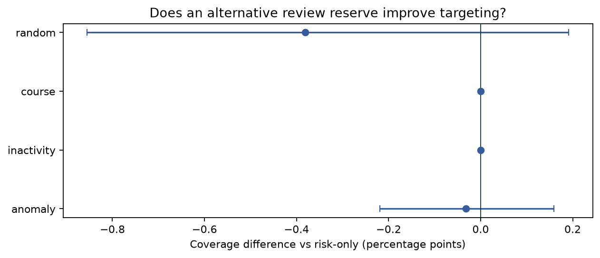
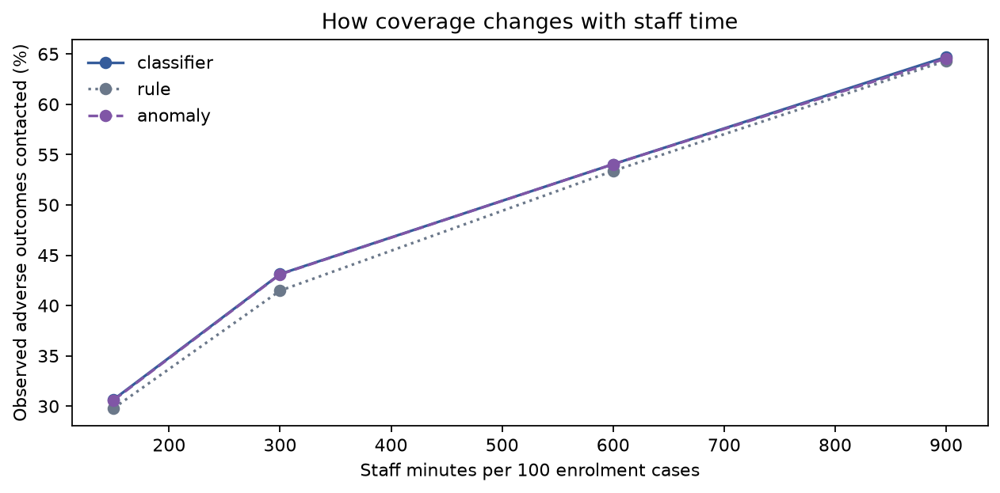
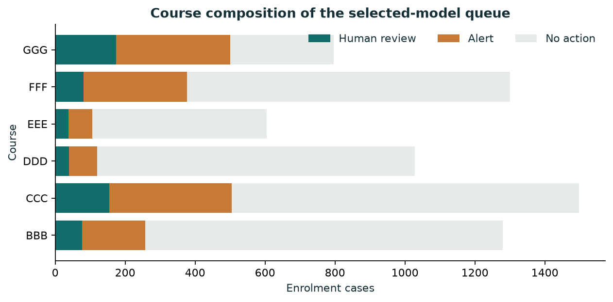
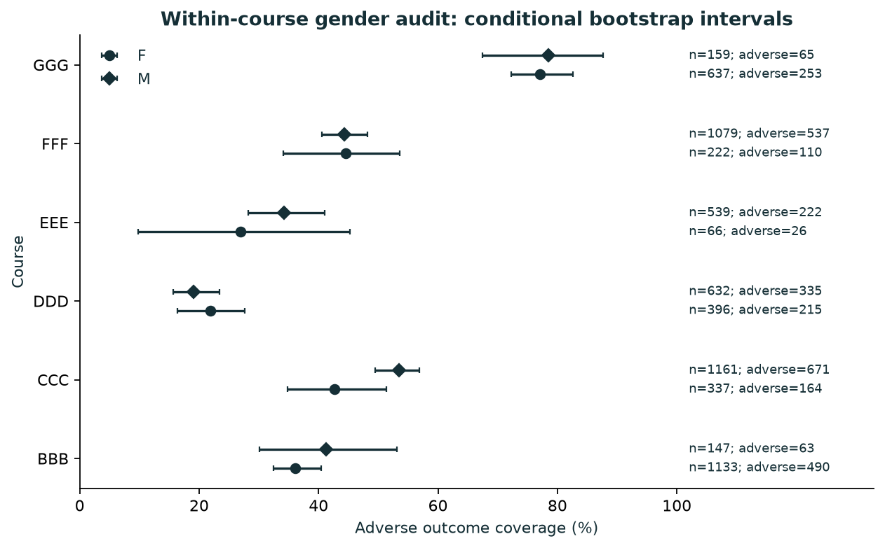

# TalentRoute: learner-support decisions under limited staff time

## Executive summary

An educational consulting team helps a university support coordinator decide which course cases staff should inspect first. TalentRoute estimates later outcomes using early activity and available assessments, then assigns review, alert or no action within a declared staffing budget. OULAD does not document current support procedures, so the workflow and effort costs are proposed assumptions.

At 300 minutes per hundred cases, the primary logistic queue contacts 1,865 of 6,508 cases. It reaches 1,359 of 3,151 later Fail/Withdrawn cases, compared with 1,307 for a simple score/inactivity rule. The difference is 52 cases. The conditional gain interval is [0.59, 2.88] percentage points. The operational companion retains mature prior enrolments and uses the same evaluation cases:

| protocol | system | adverse_contact_n | coverage | difference_vs_rule_low | difference_vs_rule_high |
| --- | --- | --- | --- | --- | --- |
| identity_disjoint | score_inactivity_rule | 1307 | 0.415 | 0.000 | 0.000 |
| identity_disjoint | selected_risk_queue | 1359 | 0.431 | 0.006 | 0.029 |
| operational | score_inactivity_rule | 1307 | 0.415 | 0.000 | 0.000 |
| operational | selected_risk_queue | 1358 | 0.431 | 0.005 | 0.029 |

Source: `outputs/proposed_system.csv`. Table proportions use 0–1 units. The primary design excludes overlapping identities from training; the operational companion retains their earlier records. Neither is a new independent test.

**Evidence status.** These are post-feedback development results. The historical 2014J test has already been examined and is excluded from this revision. No unseen cohort is available. Final held-out confirmation remains unsatisfied; more seeds, new splits and software tests cannot restore it. Intervals condition on fitted predictions/actions and omit fitting and selection uncertainty. Historical targeting does not establish prevented failures, financial return or treatment benefit.

The connected anomaly reserve changes actions but its paired coverage interval crosses zero. Therefore use zero anomaly reserve provisionally. The coordinator must validate effort assumptions and coordinate repeated learners before actual outreach.

## Problem recap and changes since the intermediate report

The owner is a learner-support coordinator assisted by an educational consulting team. The practical need is to make scarce staff time, excluded cases and alternative plans visible. Actual current university practice is unknown; the constructed score/inactivity comparator is a plausible alternative, not a measured institutional baseline. Corporate employee transfer would require different data and validation.

A review means inspecting one course-enrolment case. An alert is a shorter staff-mediated check. They are exclusive actions in this proposed queue. Multiple courses may belong to one person, so staff must coordinate contacts. The primary list contains 1821 people across 1865 cases. It is not a deduplicated outreach schedule.

The Intermediate commitments remain: classification, engagement outlier detection, constrained decisions, reconciliation, warning profiles and course/segment analysis. Feedback led to separate review routes instead of blending incompatible scores, action-level counts, course/gender audits, a returning-learner companion and one pipeline/app. Calendar checks also changed training: some historical training outcomes were not yet mature at the intended decision date. The new population differs from the old submission; their scores are not before/after evidence of improvement.

## Proposed system

Logistic regression tests a simple relationship; a bounded tree and two boosting capacities test alternatives. Three logistic penalties test sensitivity to regularization. Isolation Forest ranks unusual engagement without invented anomaly labels. Its percentile is not an outcome probability. It reserves existing review places, then the classifier fills remaining reviews and alerts. The final recommendation follows measured targeting rather than forcing the second family to succeed. Improvements concern decision validity and analysis, not adding complexity.

The budget is 300 minutes per hundred cases, with assumed 30-minute reviews and 2-minute alerts. An initial alert-budget reservation and a 20% alert-place cap determine whole-action capacities. Experimental routes reserve 20% of review places. The app changes these assumptions. Source: `outputs/parameters.csv`. No clustering or probability/percentile averaging is used.

## Evaluation setup and results

OULAD supplies actual Success (Pass/Distinction), Fail and Withdrawn outcomes. Predictors stop at day 28. Scores require an assumed seven-day publication lag; actual release timestamps are unavailable. IDs, demographics and outcomes are excluded from predictors. Imputation, scaling, encoding and detector reference ranks fit training only. Unequal activity windows are totals, not normalized daily trends.

Training uses mature 2013B outcomes; 2013J courses had not finished at the early 2014B decision point. Calendar bounds include unknown start days and assumed result-release delays:

| training_presentation | decision_presentation | release_delay_days_assumed | earliest_end | latest_end | earliest_decision | status |
| --- | --- | --- | --- | --- | --- | --- |
| 2013B | 2014B | 0 | 2013-09-28 | 2013-10-26 | 2014-03-01 | end_plus_assumed_delay_before_decision |
| 2013B | 2014B | 30 | 2013-09-28 | 2013-10-26 | 2014-03-01 | end_plus_assumed_delay_before_decision |
| 2013B | 2014B | 60 | 2013-09-28 | 2013-10-26 | 2014-03-01 | end_plus_assumed_delay_before_decision |
| 2013J | 2014B | 0 | 2014-06-18 | 2014-07-26 | 2014-03-01 | course_not_finished_by_decision |
| 2013J | 2014B | 30 | 2014-06-18 | 2014-07-26 | 2014-03-01 | course_not_finished_by_decision |
| 2013J | 2014B | 60 | 2014-06-18 | 2014-07-26 | 2014-03-01 | course_not_finished_by_decision |
| 2014B | 2014J | 0 | 2014-09-22 | 2014-10-27 | 2014-10-29 | end_plus_assumed_delay_before_decision |
| 2014B | 2014J | 30 | 2014-09-22 | 2014-10-27 | 2014-10-29 | availability_unresolved_within_bounds |
| 2014B | 2014J | 60 | 2014-09-22 | 2014-10-27 | 2014-10-29 | availability_unresolved_within_bounds |

Source: `outputs/label_availability.csv`. Metadata bounds do not establish actual result publication dates.

| protocol | split | n | students | adverse_n | prior_enrolment_n | modules | train_validation_identity_overlap |
| --- | --- | --- | --- | --- | --- | --- | --- |
| identity_disjoint | train | 3901 | 3899 | 1886 | 0 | BBB,DDD,FFF | 0 |
| identity_disjoint | validation | 6508 | 6215 | 3151 | 763 | BBB,CCC,DDD,EEE,FFF,GGG | 0 |
| operational | train | 4118 | 4116 | 2025 | 0 | BBB,DDD,FFF | 217 |
| operational | validation | 6508 | 6215 | 3151 | 763 | BBB,CCC,DDD,EEE,FFF,GGG | 217 |

Source: `outputs/populations.csv`. Identity-disjoint training is a generalization audit, not the proposed operational training population. The companion retains mature prior records. Unseen courses receive all-zero course dummy columns through `handle_unknown='ignore'`; this avoids an encoding error but provides no learned course effect or safety guarantee.

**Primary ML metric:** adverse-outcome average precision (AP), because the task ranks cases for scarce outreach and must account for both missed adverse outcomes and false flags across thresholds. **Primary decision metric:** adverse coverage under the common staffing budget, because the coordinator needs to know how many later Fail/Withdrawn cases the affordable queue reaches. This is targeting recall, not prevented failures. Action-specific counts expose the different review and alert workloads; their benefits remain unmeasured. Brier score is a secondary probability-error diagnostic. Fail and Withdrawn retain separate predictions and metrics in `outputs/model_comparison.csv`. Detector AP measures relevance to adverse outcomes, not anomaly accuracy, because anomaly labels do not exist.

| model | adverse_average_precision | average_precision_low | average_precision_high | adverse_prevalence | adverse_brier | macro_f1 |
| --- | --- | --- | --- | --- | --- | --- |
| logistic | 0.705 | 0.689 | 0.721 | 0.484 | 0.240 | 0.452 |
| logistic_c01 | 0.707 | 0.691 | 0.724 | 0.484 | 0.236 | 0.447 |
| logistic_c10 | 0.703 | 0.688 | 0.719 | 0.484 | 0.242 | 0.453 |
| tree | 0.650 | 0.633 | 0.667 | 0.484 | 0.237 | 0.437 |
| hgb_7_2 | 0.676 | 0.655 | 0.694 | 0.484 | 0.235 | 0.465 |
| hgb_15_10 | 0.664 | 0.645 | 0.683 | 0.484 | 0.238 | 0.451 |

Sources: `outputs/model_comparison.csv`, `outputs/model_intervals.csv`. AP intervals are conditional student-cluster bootstrap intervals.

| model | adverse_contact_n | coverage | adverse_average_precision | selected_development_candidate |
| --- | --- | --- | --- | --- |
| logistic | 1359 | 0.431 | 0.705 | True |
| logistic_c10 | 1358 | 0.431 | 0.703 | False |
| logistic_c01 | 1357 | 0.431 | 0.707 | False |
| hgb_7_2 | 1305 | 0.414 | 0.676 | False |
| hgb_15_10 | 1300 | 0.413 | 0.664 | False |
| tree | 1280 | 0.406 | 0.650 | False |

Source: `outputs/development_selection.csv`. The bounded selection rule maximizes development coverage, then AP, then fixed candidate order. It was recorded after earlier findings were known. The selected model is logistic and has a positive conditional gain interval against the original good-enough coverage criterion on development data only; the logistic alternatives differ by 2 reached adverse cases. Boosting reaches 1300–1305, versus 1307 for the rule. Exact CPU-platform boosting results may vary; regenerate outputs and conclusions together.

| selected_model | times_selected |
| --- | --- |
| logistic | 6 |
| logistic_c01 | 32 |
| logistic_c10 | 12 |

Source: `outputs/selection_stability.csv`. Fifty overlapping student-group half-splits choose on one half and assess on the other, keeping earlier-cohort fits fixed. Mean assessed gain is 1.67 points, empirical spread [1.03, 2.24]. This spread is not a confidence interval. It reuses examined data and does not change the selected model. Frequent C=0.1 selection shows the exact penalty is not decisive; the recorded C=1 choice remains frozen.

**Availability and selection remediation.** A pre-recorded retrospective audit removes every assessment-derived predictor, including score summaries, submission counts, lateness and missing-score indicators. The assessment-free model therefore does not rely on assumed score-release dates. Engagement and enrolment context remain subject to their stated day-28 definitions.

Both this model and an assessment-enabled comparator select among the existing six candidates using three learner-grouped folds within 2013B only. Preprocessing is refitted inside each fold; selection maximizes mean coverage, then AP. Only after selection and full earlier-cohort fitting is 2014B evaluated. The assessment-free variant is retained on availability grounds regardless of its score. No 2014J data is used.

| protocol | variant | selected_model | adverse_average_precision | coverage | adverse_contact_n | inactivity_coverage | difference_low | difference_high |
| --- | --- | --- | --- | --- | --- | --- | --- | --- |
| identity_disjoint | assessment_free | logistic | 0.661 | 0.399 | 1258 | 0.386 | -0.002 | 0.028 |
| identity_disjoint | assessment_assumption | logistic_c01 | 0.707 | 0.431 | 1357 | 0.386 | 0.029 | 0.059 |
| operational | assessment_free | logistic | 0.661 | 0.399 | 1257 | 0.386 | -0.002 | 0.028 |
| operational | assessment_assumption | logistic_c01 | 0.707 | 0.431 | 1358 | 0.386 | 0.029 | 0.060 |

Sources: `configs/availability_audit.json`, `outputs/availability_selection.csv`, `outputs/availability_audit.csv`. Intervals compare fixed model actions with an assessment-free inactivity queue under the same capacity. This removes evaluation labels from the candidate-selection step, but cannot erase prior analyst exposure to 2014B or to the original feature design. It is retrospective temporal evaluation, not independent confirmation. Report the lost targeting performance as the price of removing uncertain assessment availability. The app exposes this model separately; the original results above remain the historical development comparison.

## Ablation

Coverage is adverse-outcome recall among contacted cases. With equal contact counts, precision is an algebraic restatement, not independent evidence. Review-tier counts distinguish the more intensive action:

| route | coverage | contact_precision | adverse_reviewed | review_success_n | alert_fail_n | alert_withdrawn_n | staff_minutes |
| --- | --- | --- | --- | --- | --- | --- | --- |
| classifier | 0.431 | 0.729 | 480 | 84 | 509 | 370 | 19522.000 |
| anomaly | 0.431 | 0.728 | 470 | 94 | 513 | 375 | 19522.000 |
| random | 0.427 | 0.722 | 447 | 117 | 527 | 373 | 19522.000 |
| score_inactivity_rule | 0.415 | 0.701 | 459 | 105 | 485 | 363 | 19522.000 |

Source: `outputs/review_tier_counts.csv`. Later-successful flagged cases are observable counts, not proof that support was unnecessary. Reviews and alerts have no measured intervention effects in OULAD.

| route | changed_action_n | new_contact_n | lost_contact_n | alert_to_review_n | reserved_outside_original_contacts_n |
| --- | --- | --- | --- | --- | --- |
| classifier | 0 | 0 | 0 | 0 | 0 |
| anomaly | 97 | 9 | 9 | 35 | 9 |
| inactivity | 4 | 0 | 0 | 2 | 0 |
| course | 0 | 0 | 0 | 0 | 0 |
| random | 278 | 78 | 78 | 22 | 78 |

Sources: `outputs/policy_intervals.csv`, `outputs/action_transitions.csv`. The anomaly interval crosses zero: [-0.22, 0.16] points. At this reserve size, course and inactivity controls change 0 and 4 actions. They are weak perturbations here, not evidence that every alternative route is equivalent.

| baseline | average_precision | coverage | contact_precision |
| --- | --- | --- | --- |
| score_inactivity_rule | 0.680 | 0.415 | 0.701 |
| inactivity_rule | 0.627 | 0.386 | 0.652 |
| random_order | 0.483 | 0.282 | 0.476 |

| detector | outcome_relevance_average_precision |
| --- | --- |
| isolation_forest | 0.595 |
| inactivity | 0.627 |

Sources: `outputs/baselines.csv`, `outputs/detector_comparison.csv`. The detector result concerns this reserve, population and objective. Unusual engagement could be high or low; that is a possible explanation, not a tested cause of the result.

## Sensitivity and stability

| protocol | parameter | value | risk_minus_rule_pp | anomaly_minus_risk_pp |
| --- | --- | --- | --- | --- |
| identity_disjoint | alert_budget_fraction | 0.000 | 0.762 | -0.159 |
| identity_disjoint | alert_budget_fraction | 0.100 | 1.269 | -0.063 |
| identity_disjoint | alert_budget_fraction | 0.200 | 1.650 | -0.032 |
| identity_disjoint | alert_budget_fraction | 0.400 | 1.650 | -0.032 |
| identity_disjoint | minutes_per_100 | 150.000 | 0.857 | -0.063 |
| identity_disjoint | minutes_per_100 | 300.000 | 1.650 | -0.032 |
| identity_disjoint | minutes_per_100 | 600.000 | 0.666 | 0.000 |
| identity_disjoint | minutes_per_100 | 900.000 | 0.381 | -0.159 |
| identity_disjoint | reserve_fraction | 0.000 | 1.650 | 0.000 |
| identity_disjoint | reserve_fraction | 0.100 | 1.650 | 0.000 |
| identity_disjoint | reserve_fraction | 0.200 | 1.650 | -0.032 |
| identity_disjoint | reserve_fraction | 0.300 | 1.650 | 0.000 |
| identity_disjoint | review_minutes | 15.000 | 0.857 | 0.063 |
| identity_disjoint | review_minutes | 30.000 | 1.650 | -0.032 |
| identity_disjoint | review_minutes | 45.000 | 1.555 | -0.063 |
| identity_disjoint | review_minutes | 60.000 | 1.269 | 0.000 |
| identity_disjoint | risk_threshold | 0.000 | 1.650 | -0.032 |
| identity_disjoint | risk_threshold | 0.250 | 1.650 | -0.032 |
| identity_disjoint | risk_threshold | 0.500 | 1.619 | -0.032 |
| identity_disjoint | risk_threshold | 0.750 | 1.047 | -0.032 |
| operational | alert_budget_fraction | 0.000 | 0.825 | -0.286 |
| operational | alert_budget_fraction | 0.100 | 1.269 | -0.032 |
| operational | alert_budget_fraction | 0.200 | 1.619 | -0.063 |
| operational | alert_budget_fraction | 0.400 | 1.619 | -0.063 |
| operational | minutes_per_100 | 150.000 | 0.857 | -0.095 |
| operational | minutes_per_100 | 300.000 | 1.619 | -0.063 |
| operational | minutes_per_100 | 600.000 | 0.603 | 0.063 |
| operational | minutes_per_100 | 900.000 | 0.127 | -0.063 |
| operational | reserve_fraction | 0.000 | 1.619 | 0.000 |
| operational | reserve_fraction | 0.100 | 1.619 | -0.063 |
| operational | reserve_fraction | 0.200 | 1.619 | -0.063 |
| operational | reserve_fraction | 0.300 | 1.619 | -0.095 |
| operational | review_minutes | 15.000 | 0.889 | -0.063 |
| operational | review_minutes | 30.000 | 1.619 | -0.063 |
| operational | review_minutes | 45.000 | 1.365 | -0.095 |
| operational | review_minutes | 60.000 | 1.174 | 0.000 |
| operational | risk_threshold | 0.000 | 1.619 | -0.063 |
| operational | risk_threshold | 0.250 | 1.619 | -0.063 |
| operational | risk_threshold | 0.500 | 1.587 | -0.063 |
| operational | risk_threshold | 0.750 | 1.206 | -0.063 |

Sources: `outputs/sensitivity.csv`, `outputs/sensitivity_comparison.csv`. Each comparison uses the same budget/cost settings. For score-cutoff sweeps, the rule uses the same classifier eligibility mask but its own ordering; it is a shared-gate comparison, not a standalone rule threshold. At cutoff zero the baseline is independent of classifier eligibility.

- alert_budget_fraction: risk-minus-rule ranges from 0.76 to 1.65 percentage points (positive at every tested value); anomaly-minus-risk ranges from -0.16 to -0.03 points.
- minutes_per_100: risk-minus-rule ranges from 0.38 to 1.65 percentage points (positive at every tested value); anomaly-minus-risk ranges from -0.16 to 0.00 points.
- reserve_fraction: risk-minus-rule ranges from 1.65 to 1.65 percentage points (positive at every tested value); anomaly-minus-risk ranges from -0.03 to 0.00 points.
- review_minutes: risk-minus-rule ranges from 0.86 to 1.65 percentage points (positive at every tested value); anomaly-minus-risk ranges from -0.06 to 0.06 points.
- risk_threshold: risk-minus-rule ranges from 1.05 to 1.65 percentage points (positive at every tested value); anomaly-minus-risk ranges from -0.03 to -0.03 points.

These sweep differences are point estimates. No uncertainty intervals were estimated for the sweeps, so positive differences at all tested settings do not establish a statistically robust advantage.

The tested score cutoffs produce identical risk-only queues; they do not bind in this range. Alert shares 0.2 and 0.4 give identical counts because the alert-place cap binds. Unchanged controls are reported as non-binding. These ranges are assumptions, not measured institutional costs. Larger budgets can improve reach without improving the model. Three seeds and two training-population protocols check stability, not cross-institution validity.

| protocol | group | n | mean_predicted | observed_rate | prediction_minus_observed | brier | brier_skill_vs_group_prevalence |
| --- | --- | --- | --- | --- | --- | --- | --- |
| identity_disjoint | all | 6508 | 0.633 | 0.484 | 0.149 | 0.240 | 0.040 |
| identity_disjoint | contacted | 1865 | 0.898 | 0.729 | 0.169 | 0.220 | -0.111 |
| identity_disjoint | seen_courses | 3609 | 0.586 | 0.485 | 0.101 | 0.222 | 0.112 |
| identity_disjoint | unseen_courses | 2899 | 0.692 | 0.483 | 0.208 | 0.262 | -0.049 |
| operational | all | 6508 | 0.641 | 0.484 | 0.156 | 0.242 | 0.032 |
| operational | contacted | 1865 | 0.900 | 0.728 | 0.172 | 0.221 | -0.116 |
| operational | seen_courses | 3609 | 0.591 | 0.485 | 0.106 | 0.223 | 0.108 |
| operational | unseen_courses | 2899 | 0.702 | 0.483 | 0.219 | 0.265 | -0.063 |

Source: `outputs/calibration_diagnostics.csv`. Mean prediction minus observed rate describes over/underprediction in these samples. Brier skill compares with each group's observed prevalence as a descriptive reference, not a deployable fitted baseline. A score cutoff is not a guarantee of calibrated individual risk. Calibration diagnostics cannot identify zero-encoding or missingness as the cause of group differences. No recalibration or new model search is performed.

| group | n | mean_predicted | observed_rate | prediction_minus_observed | brier_skill_vs_group_prevalence |
| --- | --- | --- | --- | --- | --- |
| course_BBB | 1280 | 0.518 | 0.432 | 0.086 | 0.150 |
| course_CCC | 1498 | 0.621 | 0.557 | 0.064 | 0.280 |
| course_DDD | 1028 | 0.585 | 0.535 | 0.050 | 0.150 |
| course_EEE | 605 | 0.675 | 0.410 | 0.265 | -0.133 |
| course_FFF | 1301 | 0.653 | 0.497 | 0.155 | 0.028 |
| course_GGG | 796 | 0.837 | 0.399 | 0.437 | -0.714 |

Source: `outputs/calibration_diagnostics.csv`. Course-level diagnostics separate score reliability from workload allocation. A small mean gap alone cannot establish calibration; errors can cancel. GGG's overprediction accompanies concentrated workload, whereas EEE's overprediction does not imply concentrated workload. These observations motivate auditing scores and course context, not automatic course exclusions.

| review_minutes | alert_minutes | frozen_required_minutes | shortfall_minutes | deferred_n | retained_coverage | replanned_coverage |
| --- | --- | --- | --- | --- | --- | --- |
| 30.000 | 2.000 | 19522.000 | 0.000 | 0 | 0.431 | 0.431 |
| 30.000 | 3.000 | 20823.000 | 1299.000 | 44 | 0.419 | 0.423 |
| 45.000 | 2.000 | 27982.000 | 8458.000 | 188 | 0.382 | 0.395 |
| 45.000 | 3.000 | 29283.000 | 9759.000 | 217 | 0.374 | 0.388 |
| 60.000 | 2.000 | 36442.000 | 16918.000 | 282 | 0.357 | 0.375 |
| 60.000 | 3.000 | 37743.000 | 18219.000 | 304 | 0.352 | 0.371 |

Source: `outputs/workload_stress.csv`. Freeze the original queue before increasing effort. The example contingency retains original alerts first, then the highest-risk reviews that fit; remaining cases are deferred. It may retain a lower-risk alert before a higher-risk review. Replanning provides a separate comparison under the same increased costs. Feasibility is not optimal intervention value.

## Deeper analyses

**1. Cross-model reconciliation.** Equal-quota interleaving combines classifier, anomaly and inactivity lists, skips duplicates and keeps capacity fixed. It differs from a small review reserve.

| policy | coverage | contact_precision | review_success_n |
| --- | --- | --- | --- |
| round_robin_layers | 0.412 | 0.697 | 110 |
| classifier | 0.431 | 0.729 | 84 |

Source: `outputs/reconciliation.csv`. Reconciliation reaches 41.2%, compared with 43.1% for risk ranking. This does not support replacing the queue on these development outcomes.

**2. Warning-positive profiles.** Compare later outcomes among flagged cases, retaining available-score denominators:

| observed_outcome | n | score_observed_n | score_median_observed | inactivity_median | no_early_assessment_rate |
| --- | --- | --- | --- | --- | --- |
| Fail | 838 | 175 | 40.000 | 13.000 | 0.791 |
| Success | 506 | 120 | 50.000 | 10.000 | 0.763 |
| Withdrawn | 521 | 200 | 30.000 | 8.000 | 0.614 |

Source: `outputs/warning_profiles.csv`. Only 175 of 838 flagged Fail cases have an early score. Staff should check assessment schedules, submissions and marking availability before interpreting missingness. No score is not synonymous with non-submission. These profiles explain why a warning needs review; they do not establish resilience or an effective intervention.

**3. Course specialists and segment-sensitive decisions.** Fit specialists only where training class support permits; otherwise use the global logistic model. Both sides use the same fixed classifier family to isolate specialization.

| model | average_precision | coverage | contact_precision |
| --- | --- | --- | --- |
| module_logistic | 0.710 | 0.430 | 0.727 |
| global_logistic | 0.705 | 0.431 | 0.729 |

Source: `outputs/specialists.csv`. AP moves from 0.705 to 0.710; coverage moves from 43.1% to 43.0%. No observed coverage gain supports extra specialist maintenance.

| protocol | segment | seen_in_training | n | adverse_n | review_n | alert_n | coverage | coverage_low | coverage_high | contact_precision | minutes_share | review_success_n |
| --- | --- | --- | --- | --- | --- | --- | --- | --- | --- | --- | --- | --- |
| identity_disjoint | BBB | True | 1280 | 553 | 77 | 180 | 0.367 | 0.329 | 0.405 | 0.790 | 0.137 | 3 |
| identity_disjoint | CCC | False | 1498 | 835 | 154 | 351 | 0.514 | 0.479 | 0.546 | 0.850 | 0.273 | 5 |
| identity_disjoint | DDD | True | 1028 | 550 | 40 | 80 | 0.202 | 0.167 | 0.238 | 0.925 | 0.070 | 3 |
| identity_disjoint | EEE | False | 605 | 248 | 38 | 68 | 0.335 | 0.281 | 0.400 | 0.783 | 0.065 | 4 |
| identity_disjoint | FFF | True | 1301 | 647 | 81 | 296 | 0.444 | 0.406 | 0.478 | 0.761 | 0.155 | 9 |
| identity_disjoint | GGG | False | 796 | 318 | 174 | 326 | 0.774 | 0.725 | 0.818 | 0.492 | 0.301 | 60 |
| operational | BBB | True | 1280 | 553 | 78 | 179 | 0.369 | 0.329 | 0.407 | 0.794 | 0.138 | 4 |
| operational | CCC | False | 1498 | 835 | 159 | 360 | 0.526 | 0.492 | 0.557 | 0.846 | 0.281 | 5 |
| operational | DDD | True | 1028 | 550 | 35 | 75 | 0.184 | 0.150 | 0.217 | 0.918 | 0.061 | 3 |
| operational | EEE | False | 605 | 248 | 36 | 67 | 0.327 | 0.271 | 0.393 | 0.786 | 0.062 | 3 |
| operational | FFF | True | 1301 | 647 | 84 | 286 | 0.440 | 0.401 | 0.474 | 0.770 | 0.158 | 10 |
| operational | GGG | False | 796 | 318 | 172 | 334 | 0.780 | 0.731 | 0.823 | 0.490 | 0.299 | 59 |

Source: `outputs/segments.csv`. GGG receives 30.1% of staff minutes for 12.2% of cases, reaching 246/318 adverse cases at 49.2% contact precision. It contains 60 of 84 later-successful reviewed cases. DDD reaches 111/550 at 92.5% precision. This concentration needs a course-level audit. Causes and action value are untested. The historical GGG failure used a different population, so this is not a direct improvement claim.

| segment | n | adverse_n | contact_n | adverse_contact_n | coverage | contact_precision | review_success_n |
| --- | --- | --- | --- | --- | --- | --- | --- |
| F | 2791 | 1258 | 837 | 545 | 0.433 | 0.651 | 53 |
| M | 3717 | 1893 | 1028 | 814 | 0.430 | 0.792 | 31 |

| module | gender | n | adverse_n | coverage | coverage_low | coverage_high | contact_precision |
| --- | --- | --- | --- | --- | --- | --- | --- |
| CCC | F | 337 | 164 | 0.427 | 0.348 | 0.514 | 0.824 |
| CCC | M | 1161 | 671 | 0.535 | 0.494 | 0.569 | 0.855 |

Sources: `outputs/segments.csv`, `outputs/course_gender.csv`. The largest absolute within-course coverage gap is in CCC among interpretable groups. Report denominators and overlapping uncertainty; coverage similarity does not imply equal precision or causal fairness. Protected attributes remain audit-only.

| segment | n | adverse_n | coverage | coverage_low | coverage_high |
| --- | --- | --- | --- | --- | --- |
| False | 5745 | 2672 | 0.397 | 0.379 | 0.414 |
| True | 763 | 479 | 0.620 | 0.577 | 0.659 |

Source: `outputs/segments.csv`. Prior-enrolment groups describe the operational companion, not a new test cohort.

## Insights and recommendations

**Main findings.** The selected queue reaches more adverse cases than the constructed rule under the default budget, but the gain is modest and conditional on this development population. The anomaly reserve has no established additional coverage benefit. Course specialists do not improve coverage despite a slightly higher AP. More complicated models and more detection layers therefore do not automatically improve the staffing decision.

**Recommendations and conditions.** When score publication cannot be verified, use the assessment-free mode rather than assuming scores were available. Its lower coverage is an explicit trade-off, and its interval does not establish a gain over inactivity. If timestamped score availability is later established, reassess the assessment-enabled route prospectively. Retain the frozen classifier as a provisional prioritization tool and use zero anomaly reserve provisionally. Recompute the queue when actual staff effort changes: the workload stress test shows that a previously feasible list can exceed capacity. A positive budget-sweep point estimate is insufficient to promise a gain at a new institution or staffing level. Inspect course-level coverage, precision and time shares alongside the aggregate result, especially GGG's concentration and DDD's missed adverse cases. Do not interpret the score cutoff as a validated individual probability threshold. Before contacting a flagged case, check assessment availability and the learner's context.

**Preference scenarios, not intervention returns.**

| route | withdrawn_value | preference_difference | difference_low | difference_high |
| --- | --- | --- | --- | --- |
| anomaly | 1 | -25.550 | -50.582 | 3.376 |
| anomaly | 2 | -38.550 | -82.141 | 4.383 |
| inactivity | 1 | 0.000 | -5.890 | 4.677 |
| inactivity | 2 | 0.000 | -5.890 | 4.677 |

Sources: `outputs/action_value_uncertainty.csv`, `outputs/action_value_scenarios.csv`, `outputs/action_break_even.csv`. Declared Fail/Withdrawn weights, review/alert weights and successful-case flag burdens use observed outcome counts after allocation. These are preference scenarios, not estimated treatment benefit or ROI. Weights should come from stakeholders, not be optimized to favor a route. Exact crossovers do not establish a statistically reliable preference.

**What failed and what replaces it**

| Trial or assumption | Finding | Response |
| --- | --- | --- |
| Extra classifier complexity | Boosting reaches 1300–1305 versus 1359 for the selected queue. | Retain the recorded logistic choice; no expanded search. |
| Anomaly reserve | Paired interval crosses zero. | use zero anomaly reserve provisionally. |
| Averaging probability and anomaly percentile | They represent different quantities. | Separate capacity-controlled routes. |
| Historical training calendar | Some outcomes were not mature at the early checkpoint. | Use mature earlier outcomes and disclose changed population. |
| Unknown deadlines counted as on-time | Boundary test exposed the error. | Exclude unknown deadlines from lateness. |
| Identical CPU results | Boosting fits varied across hosts. | Regenerate evidence and flag changed conclusions. |

Start with a provisional review tool, not autonomous outreach. Ask the coordinator to confirm real effort, whether alerts precede or replace reviews, repeated-person handling and acceptable flag burdens. Collect actual delivery and outcomes before claims about learning benefits. This dataset cannot determine which action prevents failure.

The app's separate policy checker recomputes time, exclusive whole actions, declared action caps and score eligibility without calling the allocator or reading outcomes. Nine anonymous examples can be edited while other cases remain fixed. Before/after views show changed actions, workload and course composition. A single-case editor changes model inputs; it is a model-response experiment, not a causal counterfactual. Export omits identities, demographics and outcomes.

## Limitations and risks

Independent confirmation remains open: 2014J was previously examined, and repeated development splits do not restore an untouched test. Conditional intervals omit the full history of model and policy selection. The operational companion addresses repeated learners but is not an independent replication.

Unknown release times and sparse early assessments limit what an early warning can mean. Course drift and unequal score reliability can distort allocation even when aggregate coverage appears stable. Clicks need not indicate learning. Assumed effort and preference weights are not observed institutional costs or treatment effects; successful flagged cases do not prove unnecessary support. No punitive decision or automatic denial of support is justified. The unexecuted future protocol is in `docs/final_confirmation_plan.md`.

## Connection to the original problem and next steps

The original consulting question was how to prioritize limited learner support. This version answers who enters an affordable review queue using real educational outcomes; it does not yet answer which intervention is worth its cost. It preserves classification plus a separately evaluated anomaly route, temporal safeguards and common-budget comparisons, while making the unsuccessful additions visible.

The next step is coordinator review of the proposed workflow and effort assumptions, followed by prospective evaluation on genuinely new cases under a frozen protocol. Record who was offered which support, delivery time and subsequent outcomes. Assess intervention benefit with an appropriate prospective comparison before claiming prevented failure or financial returns. Until then, present the application as a reproducible research demonstration for human review, not a validated institutional service.

Data: [UCI OULAD](https://archive.ics.uci.edu/dataset/349/open+university+learning+analytics+dataset), Kuzilek, Hlosta and Zdrahal, CC BY 4.0. The download recipe checks pinned source hashes.
