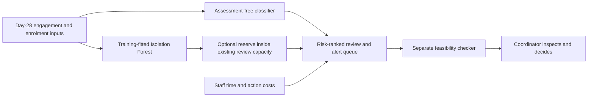
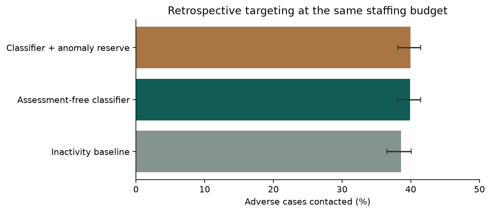
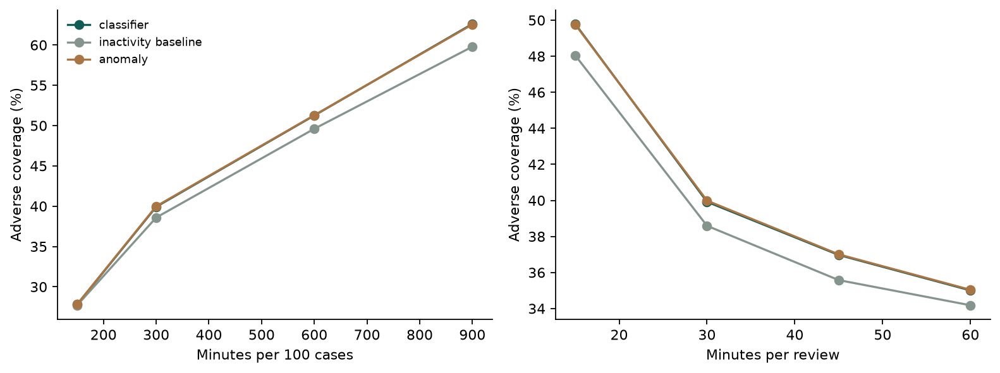

# TalentRoute: assessment-free learner-support decisions

Mouza Aldarmaki · MAAI7101 · Final project

## Executive summary

TalentRoute helps a learner-support coordinator decide which course cases to review or alert when staff time is limited. It ranks cases using early platform activity and enrolment information. Assessment scores are excluded because their release timing is unverified; submission-derived fields are also excluded as a conservative simplification, not because they are proven unavailable. A submission-only alternative was not tested.

In a previously examined cohort, the queue reaches 1,258 of 3,151 course cases with later failure or withdrawal (39.9%), versus 1,216 (38.6%) when ranking by inactivity alone at the same workload. The difference is too uncertain to establish superiority. An additional unusual-engagement detector does not establish enough extra targeting value to recommend reserving review places for it.

The practical output is an adjustable queue with a separate feasibility checker. Staffing assumptions and course composition materially change who gets attention. The recommendation is a research tool for inspecting these trade-offs, not a validated institutional policy. Historical targeting does not establish prevented failures or intervention benefits, and no untouched final test remains.

## 1. Who decides what, and why?

An educational consulting team may support universities as well as other learning providers. Its coordinator receives a list of enrolled learners at day 28 and has a finite amount of staff time. A human review means a staff member investigates a course case; an alert is a lower-effort contact. The coordinator sets available minutes, assumed effort, eligible risk scores and the share reserved for alerts. TalentRoute ranks cases and proposes mutually exclusive review, alert or no-action assignments. A person checks feasibility and decides whether outreach is appropriate.

The business question is: **How should limited review and alert capacity be directed toward learners with later observed Fail or Withdrawn outcomes, and where does that allocation fail?** This makes the university population directly relevant to the consulting scenario. There is no assertion that university learners behave like corporate employees. Applying the system elsewhere would require local data, workflow agreement and validation.

Four questions structure the evidence: Does classification outperform a simple comparator? Does an anomaly review reserve add targeting value? How do staffing assumptions and course or learner segments change the queue? Which attractive alternatives fail or remain uncertain? A valuable result can be a rejected method or a capacity constraint, rather than a higher headline score.

The intermediate design retains classification, outlier detection and three deeper investigations. Revisions address score availability, incompatible score blending and concentrated errors. Appendix B links each commitment and feedback item to evidence and the resulting decision. The archived definition already disclosed prior test use; this is not an exemption from final evaluation requirements.

## 2. Proposed system

The default uses no anomaly reserve; the connected reserve is an evaluated alternative. Later observed outcomes are used only to evaluate the frozen assignments, never by the allocator or checker.

## 3. Evaluation setup and results

OULAD is a public distance-learning dataset with registration, platform activity, assessments and observed outcomes. Each row in the modeling table is a course enrolment, not necessarily a unique person. Pass and Distinction map to Success; Fail and Withdrawn remain separate classifier classes. Their combined adverse indicator is used only for the declared targeting metric. The separate action/outcome counts prevent that combination from hiding different mechanisms. No outcome labels are simulated.

Features are restricted to information recorded by day 28: engagement counts in early and later windows, their change, inactivity, study credits, previous attempts and course. Log counts reduce extreme activity scale; inactivity represents the absence of recent recorded engagement. These are plausible warning signals, not measures of motivation or proof of causation. All numeric imputation and model-specific preprocessing fit training records only. IDs, gender, final outcomes and post-cutoff activity are not predictors. Gender is used only for audit. There is no clustering or dimensionality reduction added merely to display another technique.

OULAD does not establish exact assessment score-release dates. Restricting submission dates alone cannot prove a grade was visible. The final system conservatively removes **all five assessment-derived inputs**. The score-release issue directly concerns scores; removing submission counts, lateness and the no-early-assessment indicator is a broader simplification to avoid dependence on assessment schedules and recording assumptions. A submission-only variant was not tested, and these fields are not asserted to be inherently unavailable. Earlier 2014B diagnostics prompted this design decision; training-only candidate selection does not erase that exposure. Assessment fields retained in historical diagnostic tables are not accessed by its predictor. Mutation tests change assessments and outcomes while checking that final predictions stay identical.

Training uses 2013B; evaluation uses 2014B. Calendar interval checks account for uncertain start days and assumed result-release delays. Training on earlier completed courses is more defensible than using a possibly unfinished later presentation, but final-result publication remains an assumption. The identity-disjoint design removes overlapping evaluation identities from training. The operational companion retains mature prior enrolments and reports returning learners separately. Both evaluate the same cases; neither selects training rows using 2014J membership.

The final classifier and preprocessing are selected within three learner-grouped training folds, comparing six bounded candidates: logistic regularization levels, a constrained tree and two boosting capacities. The ranking rule is mean fold coverage, then average precision, then fixed candidate order. The selected candidate is logistic regression with C=1. Its mean fold coverage ties C=10, but its unrounded AP is slightly higher (0.730185675 versus 0.730183657); fixed candidate order did not decide this result. The chosen family is fitted on all allowed training rows before evaluation. The candidate grid reflects earlier project learning, so this separation repairs direct selection on evaluation labels but does not create a fresh experiment.

Both 2014B and 2014J were previously examined. Repeated splits, new seeds and a new freeze cannot restore independence. No fresh cohort is available. This revision does not score 2014J again and does not claim the independent final-evaluation requirement is fully satisfied. Its results are retrospective development evidence; an external future cohort remains necessary for confirmation. A supplementary nested 2013B diagnostic evaluates the selection procedure at equal capacity: 43.3% coverage versus 39.3% for inactivity. Appendix A explains its distinct population and limits.

### Models, metrics and comparators

The primary ML metric is adverse-outcome average precision (AP), appropriate for assessing ranking against the observed adverse prevalence. The final model has AP 0.661, with conditional learner-bootstrap interval [0.646, 0.678]. Brier score and class-specific metrics are also exported. The primary decision metric is the fraction of actual adverse cases contacted at a common workload. Contact precision, separate Fail/Withdrawn counts, review/alert counts and staff minutes qualify that measure. Coverage treats both contacts equally; it does not itself answer which intervention is worth its cost.

The default scenario allocates 300 staff minutes per 100 enrolments, assumes 30 minutes per review and two per alert, reserves an initial alert budget share of 20%, and caps alerts at 20% of cases. Whole-action rounding and the remaining time determine capacity. These are explicit constructed assumptions, not observed university practice. For this cohort the queue has 564 reviews and 1,301 alerts, consuming 19,522 minutes. Its contact precision is 67.5%. Reviews reach 456 adverse cases versus 444 for inactivity, while 108 versus 120 reviewed cases later succeed. These counts distinguish action tiers without claiming support was unnecessary.

Isolation Forest fits engagement features on training data only. Its training-reference anomaly percentile ranks a separately reserved portion of the existing review capacity. It is never added to the outcome probability: equal numeric ranges do not imply comparable meanings. Removing the reserve gives the default classifier-only queue. Inactivity, course round-robin and seeded-random reserves test whether the detector earns its complexity. A full inactivity-ranked queue is the transparent no-model comparator; it is distinct from reserving only some reviews for inactivity. It replaces the intermediate score-plus-inactivity rule to match the assessment-free input restriction.

All route comparisons use the same capacity. Cutoff sweeps apply the classifier eligibility mask to the inactivity comparator too, so they compare ordering among the same eligible cases. Thresholds are model-score eligibility rules, not calibrated guarantees. No threshold or cost is selected for a favorable retrospective result.

### ML-level comparison

| adverse_average_precision | average_precision_low | average_precision_high | inactivity_outcome_ap | isolation_forest_outcome_ap |
| --- | --- | --- | --- | --- |
| 0.661 | 0.646 | 0.678 | 0.627 | 0.595 |

### Training-only candidate comparison

| model | coverage | adverse_average_precision |
| --- | --- | --- |
| hgb_15_10 | 0.420 | 0.704 |
| hgb_7_2 | 0.422 | 0.715 |
| logistic | 0.438 | 0.730 |
| logistic_c01 | 0.436 | 0.730 |
| logistic_c10 | 0.438 | 0.730 |
| tree | 0.422 | 0.698 |

### Final-system results and uncertainty

| route | adverse_contact_n | coverage | contact_precision | staff_minutes | difference_low | difference_high |
| --- | --- | --- | --- | --- | --- | --- |
| classifier | 1258 | 0.399 | 0.675 | 19522.000 | 0.000 | 0.000 |
| anomaly | 1260 | 0.400 | 0.676 | 19522.000 | -0.001 | 0.002 |
| inactivity | 1258 | 0.399 | 0.675 | 19522.000 | 0.000 | 0.000 |
| course | 1258 | 0.399 | 0.675 | 19522.000 | 0.000 | 0.000 |
| random | 1254 | 0.398 | 0.672 | 19522.000 | -0.007 | 0.004 |
| inactivity_baseline | 1216 | 0.386 | 0.652 | 19522.000 | -0.028 | 0.002 |

The difference interval columns compare each route with classifier-only. The separate inactivity comparison is reported in the executive summary and exported CSV. Intervals resample learners with all their enrolments together, holding predictions and assignments fixed. They describe conditional sampling uncertainty; they exclude refitting, earlier search and workflow uncertainty. They are not prospective confidence claims or treatment-effect intervals.

The operational companion contacts 1,257 adverse cases (39.9%). This training-population sensitivity check retains the same evaluation cases; it is not an independent test or evidence that all segments are stable. Three seed checks refit the fixed selected candidate and vary tie-breaking and detector seeds; their spread is reported separately. Logistic fitting is deterministic here, so unchanged classifier coverage is expected; detector variation is the meaningful stochastic check. Seeds are not independent test populations.

## 4. Ablation

The intermediate success gate required a paired coverage-difference interval entirely above zero versus the model-free rule. The detector additionally required improvement over classifier-only with at most a two-percentage-point precision loss. Neither improvement gate is cleared here: both intervals cross zero. The detector satisfies the precision margin but not the improvement requirement. The current inactivity comparator, training population and assessment-free inputs differ from the intermediate setup; this is a disclosed revision, not a claim that the original experiment passed.

The anomaly reserve contacts 1,260 adverse cases, only 2 more than classifier-only. Its paired coverage-difference interval is [-0.10, 0.22] percentage points. It changes 83 actions, gains 4 adverse contacts and loses 2. This distinguishes changed action type from newly reached people. Detector outcome AP is 0.595, below inactivity's 0.627; outcome AP is only a relevance diagnostic because true anomaly labels do not exist. The default remains zero detector reserve.

## 5. Sensitivity, stability and concentrated failures

Five sweeps vary budget, review effort, reserve share, score cutoff and alert share, one at a time. Results and workload counts are generated for both populations using the final assessment-free predictions. The budget and effort curves show how staffing choices change the observed coverage; they do not show saved students. More resources can increase contact reach, while a higher cutoff may leave capacity unused.

| parameter | value | classifier_minus_inactivity | anomaly_minus_classifier |
| --- | --- | --- | --- |
| alert_budget_fraction | 0.000 | 10 | 1 |
| alert_budget_fraction | 0.100 | 24 | -1 |
| alert_budget_fraction | 0.200 | 42 | 2 |
| alert_budget_fraction | 0.400 | 42 | 2 |
| minutes_per_100 | 150.000 | 3 | 1 |
| minutes_per_100 | 300.000 | 42 | 2 |
| minutes_per_100 | 600.000 | 52 | 1 |
| minutes_per_100 | 900.000 | 89 | -2 |
| reserve_fraction | 0.000 | 42 | 0 |
| reserve_fraction | 0.100 | 42 | 0 |
| reserve_fraction | 0.200 | 42 | 2 |
| reserve_fraction | 0.300 | 42 | 2 |
| review_minutes | 15.000 | 55 | -1 |
| review_minutes | 30.000 | 42 | 2 |
| review_minutes | 45.000 | 44 | 1 |
| review_minutes | 60.000 | 26 | 1 |
| risk_threshold | 0.000 | 42 | 2 |
| risk_threshold | 0.250 | 42 | 2 |
| risk_threshold | 0.500 | 31 | 1 |
| risk_threshold | 0.750 | 0 | 0 |

The classifier point advantage remains positive across the tested budget and effort settings, but these sweep differences have no uncertainty intervals and the default interval crosses zero. At cutoff 0.75 the common eligibility gate leaves all queues contacting the same 966 adverse cases; this is not evidence of ranking robustness. Alert shares 0.2 and 0.4 coincide because the alert-count cap binds. Anomaly differences remain between minus two and plus two cases across these sweeps; no tested setting establishes a reason to activate the reserve.

Course GGG receives 36.2% of staff minutes while representing 12.2% of cases. It reaches 264 of 318 adverse cases (83.0%). This describes concentration in the current queue. Earlier course results used a different model and population and are not a matched before/after comparison. Course calibration and queue composition make this visible. A coordinator should review course-specific workload and score reliability before using the global queue.

Overall female adverse coverage is 48.1%, versus 34.5% for males. Contact precision is 60.1% for women and 76.1% for men. Women account for 75 of 108 later-successful reviewed cases. Within-course coverage gaps are smaller in CCC (30.5% versus 31.4%) and GGG (82.6% versus 84.6%). These patterns do not establish fairness or causally explain the aggregate gap through course mix. Within-course comparisons retain denominators and conditional intervals; groups below 50 cases or ten adverse outcomes are marked unsuitable for interpretation. No protected-attribute quota is silently introduced.

Among contacted cases, mean predicted adverse risk is 83.9%, while the observed adverse rate is 67.5%. The overstatement means displayed scores should support ranking, not be read as verified individual probabilities. Calibration would need training-only fitting followed by genuinely new evaluation; fitting a correction on this exposed evaluation cohort would not repair confirmation.

| group | n | mean_predicted | observed_rate | brier |
| --- | --- | --- | --- | --- |
| course_BBB | 1280 | 0.548 | 0.432 | 0.232 |
| course_CCC | 1498 | 0.535 | 0.557 | 0.216 |
| course_DDD | 1028 | 0.586 | 0.535 | 0.214 |
| course_EEE | 605 | 0.510 | 0.410 | 0.208 |
| course_FFF | 1301 | 0.478 | 0.497 | 0.214 |
| course_GGG | 796 | 0.770 | 0.399 | 0.354 |

The workload stress test freezes membership before changing effort. Raising reviews from 30 to 45 minutes creates a 8,458-minute shortfall. An explicit alerts-first contingency defers 188 original contacts and retains 35.3% adverse coverage. Replanning under the same stressed budget gives 37.0%. Both are feasible; neither is asserted to maximize real intervention benefit. This exposes failure and an actionable fallback instead of hiding overspend through automatic reallocation.

## 6. Three promised deeper investigations

**Equal-quota reconciliation.** Interleave classifier, anomaly and inactivity rankings at the same total quota, removing duplicate cases. The Swiss Cheese idea motivates looking for complementary misses, not assuming independent layers. The output below tests that idea directly. More layers do not guarantee better coverage, and the global risk queue remains the default.

| policy | adverse_contact_n | coverage | staff_minutes |
| --- | --- | --- | --- |
| round_robin_layers | 1244 | 0.395 | 19522.000 |
| classifier | 1258 | 0.399 | 19522.000 |

**Warning-positive profiles.** Compare later Success, Fail and Withdrawn among final flagged cases, reporting inactivity and the count with observed assessment scores. Scores here are descriptive only. A flagged learner who succeeds is neither proof of resilience nor proof of wasted support: no intervention history establishes either explanation. The analysis helps identify what staff would need to investigate rather than assigning a fabricated reason.

| outcome | n | inactivity_median | score_observed_n |
| --- | --- | --- | --- |
| Fail | 835 | 14.000 | 165 |
| Success | 607 | 10.000 | 187 |
| Withdrawn | 423 | 10.000 | 100 |

**Course specialization and learner segments.** Fit a local logistic model only where training has at least 300 cases and 30 examples per class; otherwise retain the selected global model. All models use assessment-free features. Eligibility is determined from training, never from evaluation success. The exploratory comparison below is reported without promoting the best-looking result after inspection. Returning-learner, unseen-course and within-course demographic audits accompany it.

| variant | average_precision | coverage | adverse_contact_n |
| --- | --- | --- | --- |
| global_selected | 0.661 | 0.399 | 1258 |
| module_logistic | 0.667 | 0.404 | 1272 |

These analyses sharpen the recommendation: keep the simple global queue as a transparent demonstration, review concentration explicitly, and require new evidence before adopting specialists or the detector reserve. They do not imply that the original two-family design was successful merely because both algorithms run.

## 7. Insights and recommendations

**Staffing dominates the practical decision.** Increasing available time changes reach more than adding an anomaly reserve. Agree actual effort and available staff time before model refinements. If effort rises, compare a replanned queue with the explicit contingency; neither is optimal without real action values.

**Model complexity has not established better outcomes.** Keep inactivity as a standing comparator. Treat classification as a provisional ranking and retain zero anomaly reserve. Specialists are exploratory rather than a selected deployment alternative.

**A feasible queue still needs scrutiny.** Review GGG's concentrated workload and score reliability with course staff before outreach. Do not present uncalibrated scores as verified personal probabilities. A flag initiates investigation, not a diagnosis; coordinate multiple course cases belonging to one learner.

The decision rules have explicit limits:

| Decision | Why this choice | When to reconsider |
|---|---|---|
| Assessment-free inputs | Avoid uncertain score availability | Verify input timestamps before adding assessment fields |
| No anomaly reserve | Added targeting value is not established | Require new evidence before reserving scarce review places |
| Review, alert or no action | Apply the declared ranking and staffing caps | Recheck costs and capacity when staffing changes |
| No action for an eligible case | Capacity can run out | Do not interpret it as evidence the learner is safe |
| Human approval before outreach | Feasibility does not establish intervention value | Review course concentration and repeated-learner contacts |

Coverage cannot identify the best intervention. As an additional analysis, conditional preference scenarios weight reviews and alerts separately, distinguish Fail and Withdrawn, penalize contacts to later Success cases, and subtract assumed effort. Weights are external scenario preferences applied to observed outcome counts, not to the score used for selection. This avoids the earlier circular evaluation. Break-even calculations show which assumed review value would favor a reserve, and paired fixed-action intervals show uncertainty. None estimates causal benefit, monetary ROI or the true cost of a false flag.

The action-value analysis is an additional decision-relevant deep dive. The table reports reserve-versus-risk-only preference differences under the declared default weights; intervals remain conditional and are not intervention-effect estimates.

| route | preference_difference | difference_low | difference_high |
| --- | --- | --- | --- |
| classifier | 0.000 | 0.000 | 0.000 |
| anomaly | -7.700 | -31.768 | 18.997 |
| inactivity | 0.000 | 0.000 | 0.000 |
| course | 0.000 | 0.000 | 0.000 |
| random | -53.200 | -95.643 | -9.150 |

## 8. Limitations, failed approaches and risks

In the matched training-only audit, assessment-enabled prediction reaches 1,357 adverse cases versus 1,258 assessment-free. The latter sacrifices targeting performance to remove that input dependence; it is not an accuracy improvement. Direct development-cohort model choice was replaced by training-only grouped selection, while acknowledging earlier exposure. Adding anomaly ranks did not establish incremental value; numerical probability/percentile blending was rejected. Reconciliation and specialists remain exploratory. One workbench and report generator reproduce current evidence; historical experiments are labeled separately.

The app lets a user change capacity, effort, eligibility and route, then inspect actions and workload. A separate checker tests an edited plan without outcomes. Saved-setting comparison shows entering, leaving and changed-action cases. Individual input edits rescore a fitted model; they do not manufacture a future outcome or simulate the causal effect of changing behavior. Exports omit student IDs, protected attributes and outcomes. Multiple course cases for one learner still require coordination before real outreach.

## 9. Connection to the original problem, next steps and reproduction

The coordinator receives a feasible, inspectable allocation and evidence of where it concentrates attention. This answers who could be contacted under declared constraints; it does not establish which support action prevents failure. Real workflow agreement and new outcomes are prerequisites for operational adoption.

Use Python 3.14 with `uv` and `just`: `just install`, `just pipeline`, then `just app`. The CPU pipeline verifies pinned public data, fits models, generates all comparisons and this report, and runs meaningful tests for time eligibility, training-only selection, mutation invariance, budget arithmetic, deterministic allocation and app/output consistency. Runtime is measured in `outputs/runtime.csv`. Linux reproduction checks portability; no LLM or credentials are required to run the project.

Main final-system evidence uses `outputs/final_*.csv`, labeled assessment-free and retrospective. `availability_selection.csv` records the training-fold selection; `availability_audit.csv` records the matched feature-removal comparison. Unprefixed model, route and sensitivity files are historical. The separate `nested_*.csv` diagnostic appears in Appendix A and slides 8/14.

Use the assessment-free workbench to inspect constrained decisions, with no default anomaly reserve. New outcomes and measured workflow evidence are required before deployment. Appendix B distinguishes completed experiments from established benefits; negative results remain part of the deliverable.

Data source: Kuzilek, Hlosta and Zdrahal, Open University Learning Analytics Dataset, UCI, DOI 10.24432/C5KK69, CC BY 4.0. Course concepts applied include classifier comparisons, leakage checks, error slicing, domain-grounded features, and the Beyond Predictions explain/check/compare pattern.

## Appendix A. Retrospective nested selection diagnostic

**Why.** Conditional intervals on fixed predictions omit refitting and selection. This diagnostic repeats candidate selection inside outer training folds to examine the procedure on excluded learners. It does not repair previous data exposure. Designed after the 2014B results were known, its protocol was written before execution and all folds are reported regardless of outcome.

**Method.** Use all 4,118 eligible 2013B course cases from 4,116 learners, including cases removed by the main identity-disjoint training protocol. One outer partition uses three stratified learner-grouped folds (seed 247101). All cases come from BBB, DDD and FFF in the same cohort. This checks neither temporal shift nor new courses such as GGG. Within each outer training fold, three learner-grouped folds compare the same six candidates by coverage, then average precision, then fixed order. Preprocessing refits inside each fold. Fit the chosen candidate on that outer training partition and evaluate once on its excluded learners. Use the same assessment-free inputs, action costs and capacity for classifier and inactivity queues. Every learner belongs to one outer evaluation fold. Neither 2014B nor 2014J is scored. A supplementary extension refits Isolation Forest inside each outer training fold and evaluates the existing 20% review reserve at matched action counts. Only feature columns enter outer prediction and allocation; labels are used afterwards for scoring. The reserve and candidate grid are not selected from these results.

| outer_fold | method | selected_model | evaluation_cases | adverse_contact_n | coverage | staff_minutes |
| --- | --- | --- | --- | --- | --- | --- |
| 1 | nested_selected_classifier | logistic | 1373 | 297 | 0.440 | 4118.000 |
| 1 | inactivity | logistic | 1373 | 263 | 0.390 | 4118.000 |
| 1 | nested_anomaly_reserve | logistic | 1373 | 297 | 0.440 | 4118.000 |
| 2 | nested_selected_classifier | logistic_c10 | 1372 | 289 | 0.428 | 4088.000 |
| 2 | inactivity | logistic_c10 | 1372 | 274 | 0.406 | 4088.000 |
| 2 | nested_anomaly_reserve | logistic_c10 | 1372 | 290 | 0.430 | 4088.000 |
| 3 | nested_selected_classifier | logistic_c10 | 1373 | 290 | 0.430 | 4118.000 |
| 3 | inactivity | logistic_c10 | 1373 | 258 | 0.382 | 4118.000 |
| 3 | nested_anomaly_reserve | logistic_c10 | 1373 | 291 | 0.431 | 4118.000 |

**Result.** Across 2,025 adverse cases, pooled outer-fold coverage is 43.3% versus 39.3%, reaching 81 additional cases at identical contact capacity and within budget. Logistic C=1 wins fold 1; C=10 wins folds 2 and 3. All three comparisons favor the selected classifier, but the preferred penalty varies. The fixed anomaly reserve reaches 2 additional adverse cases in total versus classifier-only, an exploratory difference that does not establish incremental benefit or change the default route.

**What this adds.** The result describes the selection procedure within the earlier 2013B population. Its larger advantage cannot establish why the later-cohort advantage is smaller, because population, training size and evaluation design differ. It is not a new independent test, a temporal estimate, or evaluation of one fixed final fitted model. Overlapping training folds do not justify an independent-fold significance claim. It neither supersedes the main 2014B comparison nor passes its original improvement gate. No final model, policy or recommendation changed. Reproduce with `just nested-audit`; source: `outputs/nested_results.csv` and `outputs/nested_inner_selection.csv`.

## Appendix B. Commitments, feedback and evidence

The reference is the [archived intermediate definition](intermediate_definition_archived.md), extracted unchanged from the locally retained November intermediate release. Its identity has not been verified against the renamed ZIP shown in the LMS submission screenshot. The archive states: "A separate frozen Final candidate already used 2014J before this revision. It is no longer unseen." It also requires preserving the original record and independent evidence before confirming a changed model. This documents the development boundary; it does not establish an instructor waiver or make the revised model independently tested.

**Reading this map.** "Executed" means the experiment or check exists, not that it passed its improvement gate. Output paths below are relative to the repository. Final comparisons and figures are regenerated by `just final-analysis`; training selection by `just availability-audit`; nested diagnostics by `just nested-audit`; `just pipeline` assembles the evidence. Archived text is a reference, not a generated experimental result.

| Promise or feedback | Evidence | What was implemented or tried | Finding, alternative and reason |
|---|---|---|---|
| University learners must fit the business problem | Report section 1; archived definition | A consulting coordinator prioritizes university course cases | Corporate employee transfer is not claimed; the dataset matches the stated learner population |
| Classification plus outlier detection | `src/talentroute/models.py`; `outputs/final_model_metrics.csv`; `outputs/final_comparison.csv` | Logistic, tree and boosting comparisons; connected Isolation Forest review reserve | Both families implemented; incremental reserve benefit unestablished, so default reserve is zero |
| Do not combine incomparable scores | `src/talentroute/decision.py`; `outputs/final_action_transitions.csv` | Replace probability/percentile addition with a separate reserve within existing capacity | Anomaly rank is not an outcome probability; retain separate meanings and compare changed actions |
| Real labels and justified features | `src/talentroute/data.py`; `tests/test_availability.py`; report section 3 | Real Success/Fail/Withdrawn outcomes; activity and recency features | No simulated anomaly or intervention labels; missing grades are not invented outcomes |
| Score availability and leakage | `outputs/availability_audit.csv`; `outputs/calendar_bounds.csv`; `outputs/label_availability.csv` | Matched assessment-enabled/free audit; calendar checks; mutation tests | Remove assessment inputs despite lower targeting; submission-only alternative untested; final-label release remains assumed |
| Compare models without evaluation-driven selection | `outputs/availability_selection.csv`; `outputs/model_settings.csv` | Learner-grouped selection within earlier training data | Logistic selected by the declared rule; earlier development exposure is not erased |
| Preserve credible baselines and equal effort | `outputs/final_comparison.csv`; `tests/test_decision.py` | Inactivity versus classifier and reserve alternatives at identical capacity | Classifier superiority not established by the interval; keep inactivity as comparator |
| Separate ML quality, decisions and value | `outputs/final_model_metrics.csv`; `outputs/final_action_value_scenarios.csv`; `outputs/final_action_break_even.csv`; `outputs/final_action_value_uncertainty.csv` | AP, coverage, action-specific outcomes, false flags and conditional value scenarios | Scenario weights are assumptions; actual prevented failures and intervention value remain unmeasured |
| Equal-quota reconciliation / Swiss Cheese | `outputs/final_reconciliation.csv` | Interleave classifier, anomaly and inactivity within one quota | Fewer adverse contacts than risk ranking; keep global risk queue, not a larger warning union |
| Warning-positive profiles | `outputs/final_warning_profiles.csv` | Compare later-successful flagged cases with Fail and Withdrawn; show observed-score denominators | Profiles guide investigation; neither resilience nor wasted intervention is demonstrated |
| Course specialists and segments | `outputs/final_specialists.csv`; `outputs/final_specialist_eligibility.csv`; `outputs/final_segments.csv` | Training-eligible specialists with global fallback | Small exploratory improvement does not justify selecting specialists after inspection |
| Show queue composition and concentrated failures | `outputs/final_segments.csv`; `outputs/final_course_gender.csv`; `outputs/figures/final_queue_composition.png` | Review/alert counts, workload shares and within-course gender audits | Inspect GGG concentration and denominators; no fairness guarantee or causal demographic explanation |
| Audit repeated-learner selection | `outputs/final_comparison.csv`; `outputs/final_segments.csv`; `outputs/populations.csv` | Identity-disjoint and operational training populations evaluated on the same cases | Training-population sensitivity, not a second independent test; coordinate repeat contacts |
| Keep sensitivity and uncertainty | `outputs/final_sensitivity.csv`; `outputs/final_stability.csv`; `outputs/nested_results.csv` | Staffing and eligibility sweeps, seeds, supplementary nested selection | Conditional uncertainty and retrospective stability; nested results do not replace temporal evidence |
| Make failed plans and alternatives visible | `outputs/final_workload_stress.csv`; `src/talentroute/plan.py`; `tests/test_plan.py` | Freeze queue, raise effort, test contingency and replan | Original plan can exceed capacity; explicit feasible alternatives are not claimed optimal |
| Explain scores honestly | `outputs/final_calibration.csv`; report section 5 | Compare model scores with observed outcome frequencies | Use scores for ranking, not verified personal probabilities; training-only temperature experiment not adopted (Appendix C); later-cohort calibration remains unresolved |
| Clear code and a working, explainable artifact | `src/talentroute/`; `tests/`; `Justfile`; `docs/presentation_script.md` | Separate data, models, decisions, analyses and checker; one workbench | Readability is inspectable, not proven by file count; demonstration explains actions without code slides |
| Preserve the test history | `docs/development_protocol.md`; archived definition; report section 3 | Keep revised evaluation retrospective and exclude previously examined final cohort | Historical candidate differs from current model. Initial exposure and availability are not fully verified; no claim that archived results confirm this revision |

### What the experiments changed

Assessment removal trades observed targeting for defensible input availability. The anomaly blend was rejected on meaning, and its separate reserve failed to establish additional targeting value. Equal-quota reconciliation was weaker than the risk queue. Specialists and nested selection were informative but did not justify changing the recommended default or declaring confirmation. The workload stress test produced a concrete failure and feasible alternatives. These outcomes preserve the promised investigations while explaining why implementation does not imply adoption.

The separate KU Leuven exploration concerns a different activity-only model and grade endpoint. It is not used to select this model or to resolve its test requirement; its numerical results are not incorporated into this report's reproducible pipeline. A historical result, a retrospective revision and a separate transfer study must not be pooled or described as interchangeable validation.

## Appendix C. Probability correction tested, not adopted

**Problem and design.** Lecture 13 distinguishes probability correction from threshold changes. Test one temperature-scaling correction, retaining three-class outcomes and assessment-free features. Use only 2013B. Within each learner-grouped outer training fold, reserve one third of learners for calibration; select among the existing six candidates and fit on the remaining two thirds only. Fit temperature by multiclass log loss on calibration learners, with fixed bounds [0.25, 4]. Score raw and corrected versions of the exact same base model on outer-assessment learners. No learner crosses these three roles, and no outer label enters fitting or allocation. This is a development-only diagnostic within 2013B, designed after earlier findings, not independent confirmation. See `docs/probability_audit_protocol.md`.

| fold | method | temperature | adverse_brier | log_loss | adverse_contact_n |
| --- | --- | --- | --- | --- | --- |
| 1 | raw | 1.000 | 0.210 | 0.927 | 295 |
| 1 | temperature | 1.012 | 0.210 | 0.927 | 295 |
| 2 | raw | 1.000 | 0.213 | 0.940 | 290 |
| 2 | temperature | 0.964 | 0.213 | 0.940 | 289 |
| 3 | raw | 1.000 | 0.218 | 0.955 | 291 |
| 3 | temperature | 1.105 | 0.218 | 0.954 | 290 |

**Result and decision.** Mean outer-fold multiclass log loss changes from 0.940850 to 0.940433 (lower is better), while adverse Brier error changes from 0.213608 to 0.213629. The corrected queue contacts 874 adverse cases versus 876 without correction at matched capacity. Both probability-metric changes are tiny and point in opposite directions; they do not establish a useful correction. Adverse Brier error is slightly higher in all three folds and two fewer adverse cases are contacted. No superiority or harm claim follows from these small differences. The design and reporting metrics were written before execution, but no numerical adoption threshold was prespecified; retaining the default is a post hoc conservative interpretation, not a passed statistical gate. Do not replace the application model or claim its probabilities are repaired. Do not compare these raw scores directly with Appendix A as a correction effect: model-fitting samples differ because calibration learners are withheld here. The identical raw total of 876 in the two diagnostics is coincidental; their fold counts differ. This raw arm is not the deployed default model.

A global temperature fitted within 2013B does not test or resolve course-specific calibration under later-cohort shift. It also does not make anomaly percentiles comparable with outcome probabilities.

Temperature scaling preserves the most likely class but can change the ranking of combined Fail-plus-Withdrawn risk. No new threshold or correction method is chosen from these results. The method was implemented and rejected for the current default; no 2014B or 2014J scoring occurred. Reproduce with `just probability-audit`; all fold results are in `outputs/probability_audit.csv`. This is an additional reliability experiment, preserving the intermediate techniques and investigations.

