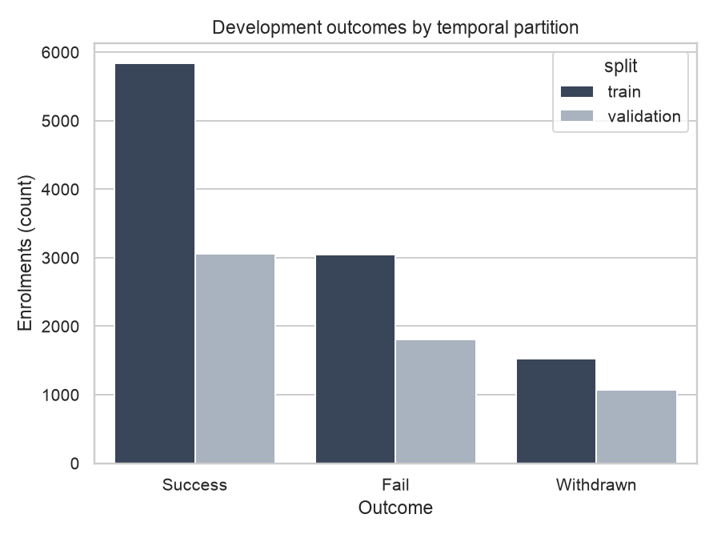
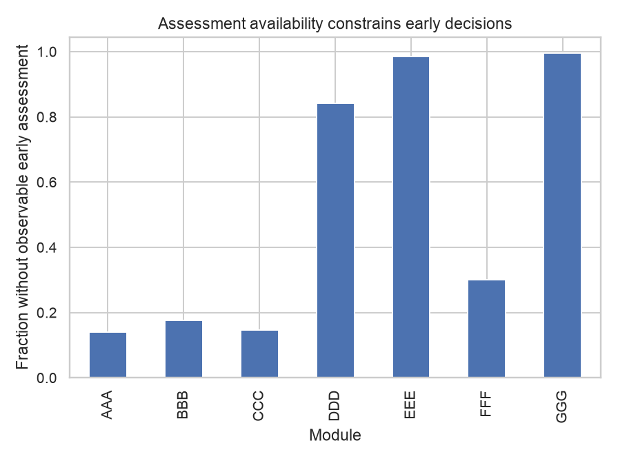
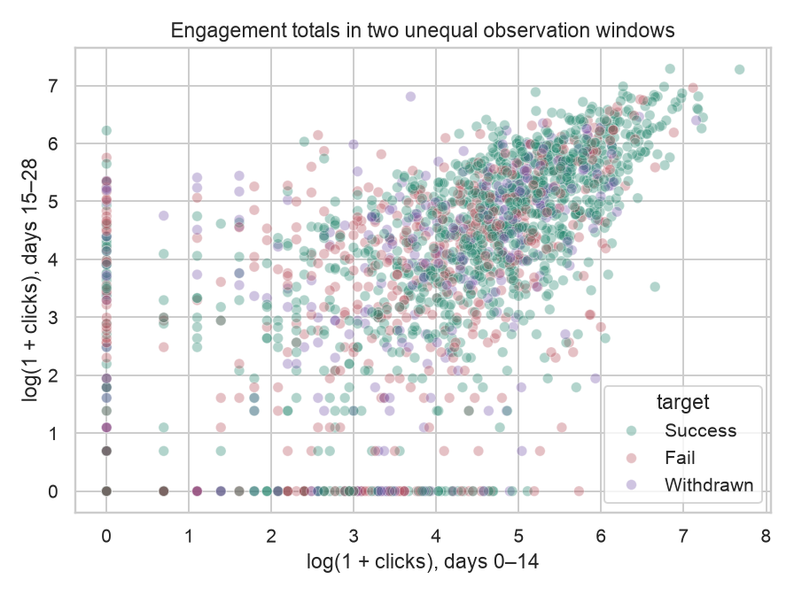

# TalentRoute: Intermediate evidence report

## Problem and decision
An educational consulting team serving universities must decide which learners receive an alert, human review or no action within limited staff time. TalentRoute uses information available at day 28 to prioritise that queue. OULAD is the evaluated learner population; corporate employee transfer and causal intervention benefit are not established.

The original recommender/uplift framing changed to classification plus engagement outlier detection because the available data support observed learner outcomes and engagement, not verified treatment benefits. The baseline, uncertainty analysis, same-budget comparisons and added-component go/no-go principle are retained. Scope and the three final commitments are in project_definition.md.

## Data and evaluation history
OULAD (Kuzilek, Hlosta & Zdrahal, 2015; doi:10.24432/C5KK69; CC BY 4.0) supplies real outcomes. Pass/Distinction map to Success; Fail and Withdrawn remain separate. From 32593 raw enrolments, 27515 meet initial eligibility; 1959 earlier records of later-partition students are purged. Training: 10412 (2013B/J); validation: 5934 (2014B); final cohort: 9210 (2014J). See outputs/data_audit.json.

This report and its pipeline evaluate development data. A separate frozen final candidate was already evaluated on 2014J before this update: it is no longer an unseen test. New diagnostics use training/validation only and cannot justify retuning against that observed test. Original Intermediate archives preserve the earlier chronology. Any later model change needs independent evidence for a confirmatory claim.

VLE aggregates stop at day 28. Non-banked, non-exam assessment submissions stop at day 21 under an assumed seven-day grading delay. Training-fitted imputation keeps missingness explicit. IDs, protected demographics and future outcomes are excluded from predictors. Eligibility, cutoff and identity-disjointness are tested. The data dictionary defines each variable and its availability assumption.

## What is actually implemented
Two technique families feed one policy: classification estimates three outcome probabilities; Isolation Forest maps unusual engagement to a training-reference percentile. Their weighted score ranks cases before staff-time allocation. Multiple classifiers are comparisons within one family, not extra technique families.

Executed classifier comparisons include logistic regression, a constrained Decision Tree, Random Forest, histogram gradient boosting and module-specific logistic models with global fallback. Logistic is the supervised baseline; inactivity is the detector baseline; early scores plus inactivity form the model-free decision baseline. Module eligibility is decided using training rows only.

Original settings: logistic C=1; boosting 140 iterations, learning rate 0.07, leaf/L2 candidates (7,2), (15,2), (15,10); Isolation Forest 150 trees and max_samples=512. Seed 7101. Tree/forest/specialist configurations are reproducible in revision.py. Historical selection maximized validation adverse PR-AUC; the blend search examined 0, 0.1, 0.2, 0.35 and 0.5. Later comparisons are exploratory.

## Metrics and results
Primary ML metric is adverse PR-AUC, measuring how well risk ranks later Fail/Withdrawn cases. Outcome-specific PR-AUC, macro-F1, log loss and Brier score describe discrimination and probability quality. Detector PR-AUC, flag precision and coverage measure relevance to recorded outcomes, not accuracy against nonexistent anomaly labels. Primary decision metric is adverse coverage at a fixed effort budget; precision and missed cases expose contact burden and omissions.

Classification comparison, outputs/revision/model_comparison.csv:
```csv
model,adverse_pr_auc,fail_pr_auc,withdrawn_pr_auc,macro_f1,log_loss,adverse_brier,adverse_coverage
logistic,0.7280,0.4870,0.2829,0.4001,0.9145,0.2076,0.4283
tree,0.7099,0.4650,0.2560,0.3965,0.9300,0.2114,0.4489
forest,0.7478,0.5022,0.2861,0.4115,0.9054,0.2025,0.4555
hgb_15_10,0.7472,0.4891,0.3072,0.4552,0.9021,0.2023,0.4579
module_logistic_hybrid,0.7369,0.4871,0.2807,0.4224,0.9122,0.2045,0.4475
```

Same-budget decisions, outputs/validation_decision_metrics.csv:
```csv
policy,adverse_coverage,fail_coverage,withdrawn_coverage,flag_precision,human_n,alert_n,staff_minutes
business_rule,0.4137,0.4336,0.3801,0.6994,514,1186,17792.0000
classifier_only,0.4579,0.4491,0.4728,0.7741,514,1186,17792.0000
anomaly_rule,0.3876,0.4241,0.3258,0.6553,514,1186,17792.0000
anomaly_only,0.3553,0.4042,0.2725,0.6006,514,1186,17792.0000
coupled_selected,0.4624,0.4679,0.4532,0.7818,514,1186,17792.0000
```

Detector comparison, outputs/validation_anomaly_proxy_metrics.csv:
```csv
detector,proxy_adverse_pr_auc,n,flagged_n,human_n,alert_n,adverse_coverage,human_precision,flag_precision,missed_adverse_n,staff_minutes,fail_coverage,withdrawn_coverage
isolation_forest,0.5899,5934,1700,514,1186,0.3553,0.7004,0.6006,1853,17792.0000,0.4042,0.2725
inactivity_rule,0.6300,5934,1700,514,1186,0.3876,0.7938,0.6553,1760,17792.0000,0.4241,0.3258
```

The configured scenario allows 300 staff minutes per 100 learners, 30 per review and two per alert. Up to 20% of time is reserved for alerts, capped at 20% of learners. Reviews go to highest-ranked cases; alerts go to subsequent cases. These are configurable workload assumptions, not measured intervention costs. Either contact counts equally toward coverage.

The coupled candidate covers 46.24%, versus 45.79% for classifier-only. Its paired student-cluster interval is [-0.0055, 0.0160] (validation_paired_interval.json). Because it crosses zero and follows validation selection, incremental benefit is unconfirmed. Keep the simpler classifier as the provisional operating reference. A working second component need not be a proven deployment improvement.

## EDA and Week 10 investigations
Ten figures cover outcomes, missingness, assessments, engagement, modules, detector disagreement and the budget frontier. Overview CSVs contain feature types, summary statistics, missing counts and sample development records without IDs. Missing scores are not zero; course differences are not individual ability.





The offline decision room offers three guided predict–investigate–decide cases using these saved model, detector and budget comparisons. Stakeholder prompts are illustrative, not real communications. The diagnostic investigations follow question → expected pattern → observed evidence → interpretation limit. Learning curves compare logistic/HGB at three training fractions over three seeds. HGB keeps early stopping disabled throughout this diagnostic to hold the iteration budget fixed. Its mean validation AP moves from 0.7308 to 0.7447; this does not guarantee future data gains. Individual-feature probes rank inactive_days highest at AP 0.6266; predictive strength alone cannot establish leakage. A student-grouped period classifier gives mean ROC-AUC 0.7912, suggesting detectable covariate differences, not proven concept drift. Source CSVs and fingerprints: outputs/investigations/; reproduce with just investigations.

Existing train/validation diagnostics, ten shuffled-training-label controls and grouped permutation checks remain in outputs/diagnostics/. They generate hypotheses, not proof of clean labels or absence of leakage. No outcome is relabeled because a model disagrees with it. The new studies are explicitly exploratory after the separate final evaluation.

## Deeper work and final commitments
1. Layer escape at equal total quota: test whether complementary warnings reach missed adverse cases. Completed development sweeps compare all 24 orders and three tie seeds; retain negative findings rather than crediting a larger union with a larger contact budget.
2. Warning-positive Success/Fail/Withdrawn profiles: compare descriptive trajectories/observed-score summaries, without claiming resilience causes or treatment effects.
3. Global versus module-specialist models: compare pooled predictions with training-only eligibility and flexible global models; course heterogeneity does not itself justify specialist deployment.

Ablation removes/swaps classifier, detector and rule under identical constraints. Sensitivity varies budget, review/alert effort, score availability and cutoff; seed checks assess stability. Outputs/revision/ and validation_sensitivity.csv record executed development analyses. These high-level commitments remain fixed; further refinement must respect the already-observed final-test boundary.

## Practical recommendation and limitations
Use an interpretable review queue with an explicit capacity setting; audit learners lacking early assessments and module slices with minimum sample guards. Human review is required. Risk estimates are not guarantees. Detection of unusual engagement is not a verified diagnosis of learner need.

This is a reproducible day-28 prototype, not a weekly live integration. OULAD has no randomized support interventions or measured staff costs. No prevented failures, retained value, ROI or employee benefit is estimated. One development validation period, course shift and uncertain score availability constrain generalization. The report is an Intermediate development account; separate final results must not be presented as newly untouched confirmation.

Run just install and just pipeline; use just app with a chosen budget. Current runtime/platform/test results are in outputs/current_pipeline_verification.json. Historical platform evidence verifies its named snapshot only. Week 10 inspiration: Saravanan Thirumuruganathan, Debugging ML Models. All learner outcomes are real; diagnostic expectations are interpretations rather than hidden synthetic answer keys.
