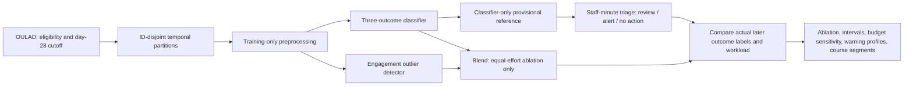

# Connected system

The detector's incremental-benefit gate is not met. No treatment effect is established. Validation selection is exploratory; 2014J was already observed for a separate frozen candidate and is not rescored here.
