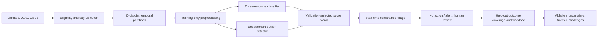

# Connected system

Validation selects models/settings. The recorded final candidate was frozen before test scoring; new development investigations do not reuse final-test outcomes for selection. The diagram describes risk targeting, not a causal chain of prevented failures.
